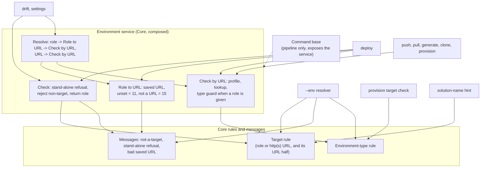

# One Environment Target Check for Every Command - Plan

## Goal Capsule

- **Objective:** Every Flowline command judges an environment the same way: what counts as a target, what a role resolves to, and which environment type a role may point at. A target that isn't a role or a URL fails with exit 15 before any PAC lookup. An environment of the wrong type fails with exit 15 before any import. Each message names the fix. No command answers a typo with advice to authenticate, and a command added later gets the same behavior without copying the checks.
- **Means:** One target rule, one environment-type rule and their messages in the core environment code (KTD1, KTD2, KTD7). One environment service in Core, composed into every command, owns the check, role-to-URL, the environment lookup and the resolve, and the command base keeps no environment logic (KTD3, KTD8, KTD10). Drift, settings, deploy, push, pull, generate, clone and provision use the service (KTD3, KTD5, KTD10). `--env` and provision reuse the rules (KTD5, KTD7, KTD9). A new command gets all of this by calling the service.
- **Authority:** This plan's Product Contract. `docs/solutions/logic-errors/unvalidated-positional-target-reaches-pac-profile-lookup.md` records the original defect. `.claude/skills/cli-for-agents/SKILL.md` governs exit codes. `docs/tone-of-voice.md` governs every message.
- **Stop conditions:**
  - Stop and ask if a test shows an exit code changing outside the cases R2 lists.
  - Stop and ask if sharing the environment-type rule cannot keep each caller's current refusals (R10), apart from the unknown-type case KTD7 names.
  - Stop and ask if moving the environment lookups out of the command base changes an exit code on push, pull, generate or clone.
- **Execution profile:** One PR. AGENTS.md (Branching) leaves branch versus `master` to the user. `ce-work` sets up a branch and worktree. One commit per unit. The wiki is touched only where U4 finds a quoted message or a deploy behavior that changes.
- **Finishes the work:** `ce-work` or a human, in the order the units are listed under Implementation Units (U1, U5, U7, U2, U3, U6, U4).

---

## Product Contract

### Summary

Two rules are each defined once in the core environment code:
- what a target is: a role (dev, test, uat, prod) or an absolute http(s) URL
- which environment type a role may point at: prod must be Production, every other role must not be

One environment service in Core owns the shared steps. It checks a target, turns a role into its saved URL, looks the environment up with the type guard, and resolves a role or URL in one call. Every command that checks an environment gets the service through the command services it already receives. The command base keeps only the command pipeline. Drift, settings and deploy move onto the service, so deploy gains the type guard and drift gains the up-front rejection. Push, pull, generate, clone and provision move their existing lookups onto it. The `--env` resolver and provision use the same two rules. A bad URL saved under a role is caught on every command, not only on deploy.

### Problem Frame

Five commands accept an environment, and each wrote its own checks.

| Command | Target check today | Type check today |
|---|---|---|
| `--env` (push, pull, generate, clone, init, provision) | `src/Flowline.Core/Environments/EnvironmentTargetResolver.cs:58-63` | own "only DEV" / "only PROD" refusals, `:71-77` |
| `deploy <target>` | `src/Flowline/Commands/DeployCommand.cs:409-414`, on the resolved address | none |
| `settings ... <target>` | `src/Flowline/Commands/SettingsSupport.cs:234-237` via `SettingsCommandBase.cs:78-80` | the base guard, through the role path |
| `drift <target>` | none | the base guard, through the role path |
| `provision [role]` | the command line limits it to dev, test, uat | own "can't overwrite Production", `src/Flowline/Commands/ProvisionCommand.cs:130` |

Drift passes any word that isn't a role straight to the PAC profile lookup (`src/Flowline/Commands/DriftCommand.cs:180-184`). `drift staging` exits 4 with "No PAC auth profile found for staging / Run: pac auth create --environment staging" (`src/Flowline.Core/Environments/ProfileResolutionService.cs:254-260`). With a universal profile active it exits 10 instead. An agent that follows exit 4's documented recovery tries to authenticate against an environment that does not exist.

Deploy never checks environment type, so `deploy prod` aimed by mistake at a sandbox imports into it. Drift and settings refuse the same mismatch through the base guard (`src/Flowline/Commands/FlowlineCommand.cs:322-329`). Microsoft's guidance puts development, test and UAT on Sandbox environments and keeps Production for business operations ([environment strategy](https://learn.microsoft.com/dynamics365/guidance/implementation-guide/environment-strategy-key-factors-affected#application-lifecycle-management)), so the guard matches how environments are meant to be used.

The duplication runs deeper than the target rule:
- Drift and settings each carry a private copy of the same steps: stand-alone role refusal, target check, and role-or-URL resolve (`DriftCommand.cs:178-192`, `SettingsCommandBase.cs:96-113`).
- The stand-alone role refusal exists in three wordings (`DriftCommand.cs:144-145`, `SettingsSupport.cs:337-339`, `DeployCommand.cs:404-407`).
- Deploy and provision each map role names by hand (`DeployCommand.cs:394-401`, `ProvisionCommand.cs:60-74`).
- The environment-type rule lives in three places with slightly different semantics: the base guard compares case-sensitively and refuses prod when the type is unknown, while the resolver ignores case and lets an unknown type pass.

A non-URL value saved under a role in `.flowline` is caught only by deploy. Drift and settings send it to the PAC lookup.

The environment lookups live in the command base (`src/Flowline/Commands/FlowlineCommand.cs`, 461 lines). The base also runs the command pipeline: setup checks, the welcome screen, telemetry, force specifiers and exit handling. Next to those it holds lookups by role, by URL and stand-alone, plus a role-to-URL wrapper (`:270-277`) that repeats the config's own lookup (`src/Flowline.Core/Config/ProjectConfig.cs:45`). Each new shared step would land there too. The repo already composes the same dependencies into a Core class for clone's environment picker (`src/Flowline/Program.cs:98-102`).

### Requirements

**Target**

- R1. `drift <target>` with a target that is neither a role nor an absolute http(s) URL exits 15 before any PAC profile lookup or artifact read, with a message that names the target and gives a runnable `flowline drift` line.
- R2. Exit codes change only in these cases. All other exit codes stay the same:
  - drift's bad target: from 4 or 10 to 15 (R1)
  - deploy by role, when the role's environment has the wrong type: newly 15 (R9)
  - any command resolving a role whose saved value isn't an http(s) URL: from 4 or 10 to 15 on drift, settings and the `--env` commands, and 15 on deploy as before (R4)
  - prod on an environment whose type the lookup didn't return: from 15 to passing the type check (KTD7)
- R3. Settings keeps its swapped-order suggestion (the caller's line with environment and name exchanged) when the component name is the environment.
- R4. A non-URL value saved under a role fails with exit 15 on every command that resolves that role, and the message names the role's `.flowline` key.

**Environment type**

- R9. Deploy by role applies the environment-type rule. `prod` must point at a Production environment, and `dev`, `test` and `uat` must not. A URL target carries no role, so the rule doesn't apply to it, as on drift and settings today.
- R10. The environment-type rule exists once. The base guard, the `--env` resolver's "only DEV" and "only PROD" refusals, and provision's target check all use it, and each keeps its current refusals and exit 15, apart from the unknown-type case KTD7 names.

**Sharing**

- R5. The target rule exists once, in the core environment code. The `--env` resolver, deploy, settings, drift and the solution-name hint all use it.
- R6. The "isn't a role or a URL" sentence exists once. Its role list comes from the role definitions, not a typed list, and each caller appends its own fix line.
- R7. The stand-alone role refusal exists once, used by drift, settings and deploy.
- R8. Drift, settings and deploy share the environment service's check, role-to-URL and resolve. None of them keeps a private target check, role mapping or role-or-URL resolve.
- R11. Provision keeps its `dev|test|uat` positional and maps it through the shared roles. No hand-written role-name or label switch remains.
- R12. Every check-and-throw environment lookup goes through the environment service. The command base keeps no such helper, role-to-URL wrapper or role label.

### Key Decisions

- **Share the rule, the messages and the drift/settings path, not only the rule.** (session-settled: user-directed — chosen over sharing only the predicate: the user asked to "share or reuse as much as possible, not only the rule".) Governs R5, R6, R7, R8.
- **Exit codes change only where the new code is more correct.** (session-settled: user-directed — chosen over keeping every exit code unchanged: the user asked why exit codes were frozen, and chose more correct codes over a refactor-only rule.) Governs R2, R4.
- **Deploy takes the full environment-type guard.** (session-settled: user-directed — chosen over deploy staying without a type check, or a prod-only check: Microsoft places UAT and test on Sandbox, and the user preferred one rule for every command.) Governs R9.
- **Share the environment-type rule and provision's role mapping too.** (session-settled: user-directed — chosen over leaving them to a follow-up: the user picked the wider reuse.) Governs R10, R11.
- **Environment logic moves out of the command base into a composed Core service, now.** (session-settled: user-directed — chosen over keeping it in the base, and over Core functions with the lookup left in the base: the user flagged the base becoming a god class and chose composition in this change.) Governs R8, R12.

### Scope Boundaries

- Deploy keeps its step order. It turns the target into a URL at the top of the run and checks the environment only after the git-clean check. It calls the shared steps at those two points rather than as one merged step, so its output order stays as it is (KTD5).
- The PAC profile lookup's URL parse (`ProfileResolutionService.cs:308`, which adds `https://` to a bare host) and the display-name formatter (`FlowlineCommand.cs:166`) stay as they are. Both accept different input on purpose.
- Settings' swapped-order and missing-name builders stay in settings. They depend on component names and settings argv, which only settings has.
- Provision's positional stays limited to `dev|test|uat` at parse time. Replacing it with the general role list would need a hand-written "not prod" check in its place.
- Three direct validator calls stay where they are, because none of them is a check that throws:
  - provision's target existence lookups (`ProvisionCommand.cs:93`, `:117`), where no result means "create it"
  - the lookup each command hands to the `--env` resolver (push, pull, generate, clone, init)
  - the base's solution lookups
- The command base keeps its solution checks, the Dataverse connection helper and the pack-and-build check. They are not environment lookups, and moving them is its own refactor.
- The `--env` resolver stays its own Core class. It owns picking and saving a URL, a different job from looking an environment up, and it already uses the shared rules (KTD5, KTD7).
- Type-guard messages stay with their callers. The `--env` refusal names `--env`, provision's says it won't overwrite, and the base guard's points at `.flowline`. Only the decision is shared (KTD7).
- Considered and not built: a near-miss suggestion for a mistyped role ("did you mean test?"). Nothing in the request calls for it. A user report of near-miss typos would change that.

#### Deferred to Follow-Up Work

- The review's other advisories on the settings branch: negative-branch tests for the name guard, the placeholder wording assertion, and leftover push/pull comments. They are separate work.
- Moving the command base's solution checks and Dataverse connection helper into composed services, the same way.

---

## Planning Contract

### Key Technical Decisions

- KTD1. **The target rule lives beside role parsing in the core environment code.** It has two parts: "is an http(s) URL", and "is a role or an http(s) URL". The `--env` resolver is in Core and needs the URL half after its role and saved-URL branches. Settings, drift, deploy and the solution-name hint need the whole rule. Core already owns role parsing (`src/Flowline.Core/Environments/EnvironmentRole.cs`), and Core must never reference `Flowline` (AGENTS.md, Project boundary rule), so Core is the only home all callers can reach.
- KTD2. **The shared target messages live with the rule in Core.** "'X' isn't a role (dev, test, uat, prod) or a URL." is built once. The role list is joined from the role helper's dev-first list (`EnvironmentRoles.All`), not the enum's declared order, so it reads dev, test, uat, prod and matches today's `--env` wording. Each caller passes its fix line:
  - `--env`: "pass --env <dev|test|uat|prod|url>"
  - deploy and drift: "Run: flowline <command> <dev|test|uat|prod|url>"
  - settings fallback (no swap): its current "Pass a role ... or the full https:// URL" intent

  The stand-alone role refusal also moves here, as one message based on the settings wording: it names the role, says roles resolve from `.flowline`, and says to pass the URL. The saved-URL message from KTD8 sits here too.
- KTD3. **The environment service owns the check and the resolve** (KTD10).
  - The check refuses a role in stand-alone mode (exit 11, KTD2's refusal), rejects a non-target (exit 15), and returns the role or nothing.
  - Settings' builder owns its whole non-target message: the swapped-order line when the swap applies, otherwise KTD2's sentence with the settings fix line. With no builder, the check uses KTD2's sentence with the caller's fix line.
  - The resolve sends a role through KTD8's role-to-URL step and then the service's check-by-URL with that role, so the type guard applies. A URL goes to the same check with no role, so the guard doesn't apply (R9). No new resolver gets written.
- KTD4. **The service's check-by-URL takes on what the private copies did better.** It replaces the base's check by URL and its stand-alone variant. The stand-alone variant becomes the same check with the DEV role, so it refuses Production as today, and its "Dev: X (url)" line becomes the common success line. Its not-found message names the URL. It escapes the URL in its progress line. A role-less run reads cleanly, where today's label gives "Environment environment not found" and "Environment env ... exists" for a null role. Without this, drift and settings would regress against their current "Environment not found". Push, pull, generate and clone get the same wording, with their exit codes unchanged.
- KTD5. **Deploy uses the service at its own two points; `--env` reuses the rules.** (session-settled: user-directed — chosen over deploy sharing only the rule and messages: the user asked to reuse as much as possible, accepting the "Target:" line change.)
  - At the top of the run, deploy calls the service's check and KTD8's role-to-URL step. Its hard-coded role switch, its URL check and its private messages go away.
  - After the git-clean check, deploy calls the service's check-by-URL with the role from the top step. That applies the type guard by role (R9) and none for a URL target. The green "Target: X (url)" line becomes the service's success line. The solution lookup and the managed/unmanaged checks stay deploy's own.
  - Today deploy's unconfigured-role message reads "provide an explicit URL or check your .flowline config". It becomes KTD8's message naming the `.flowline` key. Exit 11 is unchanged.
  - `--env` keeps its order (role, then saved URL, then the URL check) and swaps its inline parse and sentence for the shared ones.
- KTD6. **CHANGELOG.** The existing Unreleased > Changed bullet for settings targets becomes "A `settings` or `drift` target ...", adding drift's old exit 4 or 10. A Changed bullet covers the saved-URL fix (R4) and the reworded messages listed under System-Wide Impact. A Breaking bullet covers deploy's new type refusal (R9). (session-settled: user-directed — chosen over filing it under Changed: a deploy by role that succeeds today can now exit 15, which can stop a working pipeline.) It names the way through for an environment that is deliberately typed otherwise, such as a Default or Trial environment used as prod: pass its URL instead of the role, which carries no type check.
- KTD7. **One environment-type rule in Core.** It takes a role, an environment type, and whether the caller accepts DEV only. It returns whether the pair is refused and why: Production under a non-prod role or a DEV-only caller, or a non-Production environment under prod.
  - The comparison ignores case, which is the resolver's behavior today.
  - An unknown type is never refused. The resolver's profile-less lookup can return none, and an unknown type can't prove a mismatch. The base guard used to refuse prod when the type was missing. That edge narrows here, and the type is always present on a live environment lookup.
  - Callers keep their own wording: the service guard's two messages (today's base guard wording), the resolver's "--env" refusal, and provision's "Can't overwrite a Production environment". Every refusal stays exit 15.
- KTD8. **Role-to-URL is one service step.** It looks up the role's saved URL through the config, which the caller passes in (`src/Flowline.Core/Config/ProjectConfig.cs:35`). When nothing is saved, it fails with exit 11 and today's "<ROLE> URL isn't set in .flowline" message. The base's role-to-URL wrapper (`FlowlineCommand.cs:270-277`) goes. Provision, its only other caller, uses the config's own lookup. When the saved value isn't an http(s) URL, it fails with exit 15, naming the key, for example "UatUrl in .flowline isn't an http(s) URL" (R4). The saved-URL check itself lives in Core beside the target rule, so the `--env` resolver's role-keyword and saved-URL branches (`EnvironmentTargetResolver.cs:36-44`) call it too. The service step wraps it with the config lookup. The resolve uses that step for drift and settings, and deploy calls it directly.
- KTD9. **Provision maps its positional once.** The `dev|test|uat` value becomes a shared role at the start of the run. The display suffix comes from the shared role label, which already reads Dev, Test and UAT. That label moves out of the base into Core beside the other role labels, because clone's picker uses it too (`src/Flowline/Commands/CloneCommand.cs:162`). The config lookup and the copy-type choice use the shared role. The target check uses KTD7 with that role.
- KTD10. **One environment service in Core, composed like clone's environment picker.** Its inputs are the console, the profile service, the validator and the runtime options, all Core types. It is registered once at the composition root (`src/Flowline/Program.cs`) next to the picker, and handed to commands through the command services bundle (`src/Flowline/Commands/CommandServices.cs`). That way no command constructor changes, and the base exposes it as a single property.
  - It owns the check (KTD3), role-to-URL (KTD8), check-by-URL with the type guard (KTD4, KTD7), check-by-role (role-to-URL, then check-by-URL) and the resolve (KTD3).
  - The caller passes the config and the stand-alone flag. The service holds no project state, so one instance serves every command.
  - It never launches a process. The validator and profile service already wrap pac behind delegates bound in `Flowline`, which keeps it within the Core boundary (AGENTS.md, Project boundary rule).
  - The base's environment helpers, its role-to-URL wrapper and its role label are deleted, not kept as forwarding shims (R12).

### High-Level Technical Design

Who uses which shared piece after the change:

### System-Wide Impact

- **Agents and scripts:** exit codes change only in the cases R2 lists. The one that can stop a pipeline that works today is deploy by role into a wrongly typed environment (R9).
- **Users reading output:** these messages change wording:
  - the not-a-target sentence on `--env`, deploy and settings (KTD2)
  - the stand-alone role refusal on drift, settings and deploy (KTD2)
  - deploy's unconfigured-role message, and its "Target: X (url)" line (KTD5)
  - the environment check's progress, success and not-found lines on every command that checks an environment, including the stand-alone push and generate line "Dev: X (url)" (KTD4)
- **Contributors:** a new command that takes an environment calls the service. The command base no longer offers environment helpers (R12).
- **Wiki:** deploy's page and the command reference describe what deploy checks before importing. The type refusal is new deploy behavior, so U4 updates those pages.

### Risks & Dependencies

- Moving the lookups touches every command that checks an environment. The existing command tests are the guard. U7 moves the base's environment tests (`tests/Flowline.Tests/FlowlineCommandTests.cs`, the type-guard and not-found cases) to Core service tests unchanged in intent, so a lost case shows up as a missing test, not a silent gap.
- Tests that assert the environment check's exact lines will fail and need updating. That is expected.
- Tests that reach the base's lookups do so through a probe subclass that swaps the validator (`tests/Flowline.Tests/FlowlineCommandTests.cs:98-121`). They construct the service with the test validator (`TestValidator.Create()`) instead, which is simpler.
- The type guard changes from a case-sensitive to a case-insensitive comparison, and stops refusing an unknown type (KTD7). Both widen what passes only in edge cases a live lookup does not produce.
- The drift role wrapper in `DriftCommand` is used by settings (`SettingsCommandBase.cs:73`) and named in a doc comment (`EnvironmentRole.cs:48-49`). It goes away in favor of the core role parse, so both references move with it.

---

## Implementation Units

### U1. Target rule and messages in Core

**Goal:** The target rule and the shared messages exist once in the core environment code, and the `--env` resolver uses them.

**Requirements:** R4, R5, R6, R7; KTD1, KTD2, KTD8

**Dependencies:** none

**Files:**
- `src/Flowline.Core/Environments/EnvironmentRole.cs` (or a sibling file in the same folder if that keeps the role file focused)
- `src/Flowline.Core/Environments/EnvironmentTargetResolver.cs`
- `tests/Flowline.Core.Tests/EnvironmentTargetResolverTests.cs`
- a Core test file for the rule and messages, beside the existing role tests

**Approach:**
1. Add the two target predicates (KTD1), the saved-URL check (KTD8) and the message builders (KTD2).
2. Point the `--env` resolver's URL check and sentence at them, and run the saved-URL check on its role-keyword and saved-URL branches. Its order stays.
3. Update the doc comment at `EnvironmentRole.cs:48-49`, which names the drift method that U2 removes.

**Patterns to follow:** `EnvironmentRoles.Keyword` / `TryParse` for the role list. The existing settings predicate (`SettingsSupport.cs:234-237`) for the rule's exact semantics: absolute URI, http or https only, no bare host.

**Test scenarios:**
- Each role keyword in any case is a target, for example `dev`, `PROD`.
- `https://contoso.crm4.dynamics.com` and `http://localhost:5555` are targets and are URLs.
- `contoso.crm4.dynamics.com` (no scheme), `staging`, `ftp://x`, an empty string and a Windows path are not targets.
- The URL half rejects a role keyword (`prod`).
- The not-a-target sentence names the value, lists dev, test, uat, prod in that order, and ends with the caller's fix line.
- The stand-alone refusal names the role and says to pass the environment URL.
- The saved-URL message names the role's `.flowline` key and the bad value.
- `--env staging` still exits 15, and its message still contains "pass --env" (existing resolver test, wording updated).
- Covers R4. `--env uat` with `UatUrl` holding `not-a-url`: exit 15 naming `UatUrl` and `.flowline`.

**Verification:** Core tests pass, and the `--env` resolver has no inline URL parse left.

### U5. One environment-type rule

**Goal:** The environment-type decision exists once, and the base guard, the `--env` resolver and provision's target check use it.

**Requirements:** R10; KTD7

**Dependencies:** U1

**Files:**
- `src/Flowline.Core/Environments/EnvironmentRole.cs` (or the sibling file U1 used)
- `src/Flowline.Core/Environments/EnvironmentTargetResolver.cs`
- `src/Flowline/Commands/FlowlineCommand.cs`
- `src/Flowline/Commands/ProvisionCommand.cs`
- `tests/Flowline.Core.Tests/EnvironmentTargetResolverTests.cs`
- a Core test file for the type rule
- `tests/Flowline.Tests/ProvisionCommandTests.cs` (or the existing provision test file)

**Approach:**
1. Add the type rule to Core (KTD7).
2. The base guard calls it and keeps its two messages. U7 then moves that guard into the service as it is.
3. The resolver's "only DEV" and "only PROD" refusals call it and keep their "--env" wording.
4. Provision's target check calls it with the target role and keeps its "Can't overwrite" message and exit 15.

**Test scenarios:**
- prod + Production: allowed. prod + Sandbox: refused.
- uat, test or dev + Production: refused. uat + Sandbox: allowed. dev + Developer: allowed.
- A DEV-only caller with no role + Production: refused.
- Any role + unknown type: allowed.
- Type compared without case: prod + `production` allowed.
- Existing resolver tests for `--env` with a Production URL on push, and a Sandbox URL as provision's source, still exit 15 with their current wording.
- Provision aimed at an existing Production target still exits 15 with "Can't overwrite a Production environment".

**Verification:** No type comparison against "Production" remains in the resolver, the base guard or provision, apart from the shared rule.

### U7. Environment service in Core

**Goal:** One composed Core service owns every environment step, and the command base keeps no environment logic. Push, pull, generate, clone and provision use the service with their exit codes unchanged.

**Requirements:** R4, R10, R12; KTD3, KTD4, KTD8, KTD10

**Dependencies:** U1, U5

**Files:**
- a new service file in `src/Flowline.Core/Environments/`
- `src/Flowline.Core/Environments/EnvironmentRole.cs` (role label moves here)
- `src/Flowline/Program.cs`
- `src/Flowline/Commands/CommandServices.cs`
- `src/Flowline/Commands/FlowlineCommand.cs`
- `src/Flowline/Commands/PushCommand.cs`, `PullCommand.cs`, `GenerateCommand.cs`, `CloneCommand.cs`, `ProvisionCommand.cs`
- the 10 places tests build the command services bundle, in 8 files: `CloneCommandTests`, `UpdateNoticeWiringTests`, `FlowlineCommandTests`, `DiffCommandTests`, `FlowlineCommandStandaloneTests`, `InitCommandTests`, `SettingsCommandSurfaceTests` (3) and `ScaffoldCommandTests`. Each builds the service from the same console, profile service, validator and runtime options instances it gives the bundle, so the two never read different options.
- `tests/Flowline.Tests/FlowlineCommandTests.cs` (environment cases leave)
- a new Core test file for the service

**Approach:**
1. Create the service per KTD10 with check (KTD3), role-to-URL (KTD8), check-by-URL with the type guard (KTD4), check-by-role and resolve. Move the base's lookup bodies in rather than rewriting them.
2. Register it at the composition root next to clone's environment picker, add it to the command services bundle, and expose it from the base as one property.
3. Switch the base's existing callers to the service: push and generate (by URL and stand-alone), pull, clone (by URL, and the role label in its picker), provision (source by URL, and the config's own role-to-URL in place of the base wrapper).
4. Delete the base's environment helpers, its role-to-URL wrapper and its role label (R12).
5. Move the environment test cases to the Core service tests.

**Patterns to follow:** clone's environment picker (`CreateEnvironmentResolver`, registered at `src/Flowline/Program.cs:98-102`) for a Core class composed from the console, the profile service and the validator. `TestValidator.Create()` for tests.

**Test scenarios:**
- Moved from the base tests, same intent: role DEV + Production type refused; the skip-type-guard path passes; no role + Production passes; DEV-only + no role + Production refused; environment not found exits 10.
- Not-found message names the URL. The progress line escapes a URL holding square brackets.
- No role: lines read "Environment not found" and the common success line, not "Environment environment".
- Check-by-role with `UatUrl` unset: exit 11. With `UatUrl` holding `not-a-url`: exit 15 naming `UatUrl`.
- A resolved profile passed in is reused, not looked up again (the existing connect test's intent, for lookups).
- Push stand-alone against a Production URL still exits 15. Pull, generate and clone keep their existing test outcomes.

**Verification:**
- `FlowlineCommand.cs` holds no environment lookup, role-to-URL wrapper or role label.
- Full CLI and Core suites pass with no exit-code assertion changed for push, pull, generate or clone.

### U2. Drift and settings on the service

**Goal:** Drift and settings use the service's check, role-to-URL and resolve. Drift rejects a bad target with exit 15 before the artifact read and the PAC lookup.

**Requirements:** R1, R3, R4, R8; KTD3, KTD8

**Dependencies:** U7

**Files:**
- `src/Flowline/Commands/DriftCommand.cs`
- `src/Flowline/Commands/SettingsCommandBase.cs`
- `src/Flowline/Commands/SettingsSupport.cs`
- `src/Flowline/Settings/SolutionNameSettings.cs`
- `tests/Flowline.Tests/DriftCommandTests.cs`
- `tests/Flowline.Tests/SettingsCommandTests.cs`
- `tests/Flowline.Tests/SettingsCommandSurfaceTests.cs`
- `tests/Flowline.Tests/SolutionNameSettingsTests.cs`

**Approach:**
1. Settings: its role-or-throw method becomes a call to the service's check, passing its builder. Its private resolve is deleted, and its four call sites use the service's resolve. Remove the settings copies of the predicate and the stand-alone refusal.
2. Drift: replace the stand-alone check at `DriftCommand.cs:66` with the service's check, so the order stays "target before artifact". Replace the private resolve with the service's resolve. Delete the private role-parse wrapper and stand-alone message.
3. The solution-name hint (`SolutionNameSettings.cs:41`) calls the core rule.

**Patterns to follow:** `SettingsCommandSurfaceTests.cs` probes and its `Unreachable` target constant for URL-shaped input that never resolves.

**Test scenarios:**
- Service check, `staging` in a project: exit 15, message names `staging` and carries the caller's fix line.
- Service check, `staging` with a caller-built message: that message is used verbatim.
- Service check, `prod` in stand-alone mode: exit 11 with the shared refusal.
- Service check, `prod` in a project: returns the role. An http(s) URL returns no role and does not throw.
- Covers R4. Drift or settings by `uat` with `UatUrl` holding `not-a-url`: exit 15 naming `UatUrl`, before any PAC lookup.
- Covers R3. Settings swapped order (`settings toggle ApprovalFlow prod`): the existing swapped-line test still passes unchanged.
- Settings non-target with no swap: exit 15, the shared sentence with the settings fix line, not drift's.
- Drift: the fix line reads `flowline drift <dev|test|uat|prod|url>`.
- Existing stand-alone refusal tests in drift and settings point at the shared message and still assert the role name and "URL".
- The solution-name hint still picks `--env` for `dev` and a URL, and `--solution-name` for `Contoso`.

**Verification:**
- `SettingsSupport` and `DriftCommand` no longer contain a URL parse, a stand-alone message or a role-or-URL resolve.
- A Release build of `flowline drift staging` in a project folder exits 15 with the shared sentence, before any PAC output.
- A Release build of `flowline drift prod --path x.zip` outside a project exits 11 before reading the zip.

### U3. Deploy on the service

**Goal:** Deploy's target check, role lookup, stand-alone message and environment lookup come from the service, and it gains the type guard by role. Its step order is unchanged.

**Requirements:** R4, R5, R6, R7, R8, R9; KTD4, KTD5, KTD8

**Dependencies:** U7

**Files:**
- `src/Flowline/Commands/DeployCommand.cs`
- `tests/Flowline.Tests/DeployCommandTargetResolutionTests.cs`

**Approach:**
1. Top of the run: the service's check, then role-to-URL for a role or the URL as given. This replaces the hard-coded switch, the inline URL check and the private messages. Keep the role for step 2.
2. After the git-clean check: the service's check-by-URL with that role replaces the profile, spinner and not-found part of target validation, reusing the profile it returns. The solution lookup and managed/unmanaged checks stay.
3. The static target-resolution method used by the tests either goes or becomes a thin call into the service. Whichever leaves less code wins.

**Test scenarios:**
- `bogus-target`: exit 15, message names it and carries `flowline deploy <dev|test|uat|prod|url>`.
- Covers R4. `UatUrl` holding `not-a-url`, target `uat`: exit 15 naming `UatUrl` and `.flowline`.
- `uat` unconfigured, stand-alone: exit 11 with the shared refusal text.
- `uat` unconfigured, project mode: exit 11 with KTD8's "isn't set in .flowline" message.
- A configured role in any case (`UAT`) and an explicit URL resolve to the expected URL.
- Covers R9. Through the service: `uat` with a Production-typed result exits 15, `prod` with a Sandbox-typed result exits 15, and a URL target with a Production-typed result passes.

**Verification:**
- Deploy tests pass. `DeployCommand` has no inline URL parse, no role switch and no private environment lookup.
- A Release `deploy staging` exits 15 before the git-clean check.

### U6. Provision maps through the shared roles

**Goal:** Provision's positional maps once to a shared role, and its suffix, config lookup and copy type use it.

**Requirements:** R11; KTD9

**Dependencies:** U7

**Files:**
- `src/Flowline/Commands/ProvisionCommand.cs`
- `tests/Flowline.Tests/ProvisionCommandTests.cs` (or the existing provision test file)

**Approach:** Replace the suffix switch and the role mapping switch (`ProvisionCommand.cs:60-74`) with one mapping to the shared role at the start of the run. Take the default suffix from the shared role label. The copy-type choice takes the shared role. The positional stays `dev|test|uat`.

**Test scenarios:**
- `test` and `uat` default to a full copy, and `dev` to a minimal copy (existing copy-type tests, moved to the shared role).
- The default suffix is `Dev`, `Test` or `UAT` for each role, so target URLs keep their current shape.
- `provision prod` is still rejected by the command line.

**Verification:** No role-name or label switch remains in `ProvisionCommand`.

### U4. CHANGELOG, wiki, learning, sweep

**Goal:** The docs describe the new behavior, and no stale message text remains.

**Requirements:** R1, R2, R4, R9; KTD6

**Dependencies:** U2, U3, U6

**Files:**
- `CHANGELOG.md`
- `docs/solutions/logic-errors/unvalidated-positional-target-reaches-pac-profile-lookup.md`
- `../Flowline.wiki/08-Deploy.md` and `../Flowline.wiki/04-Command-Reference.md` (deploy's checks), plus any page the sweep finds

**Approach:**
1. CHANGELOG per KTD6.
2. Wiki: read `../Flowline.wiki/AGENTS.md` first. Add the type refusal where the deploy pages list what deploy checks before importing.
3. In the learning, the Prevention table's drift row becomes guarded, and the closing note about `drift staging` reproducing is replaced by where the service lives. This is an inaccuracy fix to a learning, which the learnings guidance allows.
4. Search README, `plugin/`, `src/`, `docs/` (excluding dated records) and `../Flowline.wiki` literally for the old sentences: "isn't a known target", "no config here to check", "isn't an environment. Pass a role", "check your .flowline config". Read every hit. The exit-code table in `04-Command-Reference.md:377` already says "a target that isn't a role or URL" and needs no change.

**Test expectation:** none, docs only.

**Verification:** The sweep output shows no stale sentence outside dated records, and the deploy pages name the type refusal.

---

## Verification Contract

| Gate | Command or check | Proves |
|---|---|---|
| Core tests | `dotnet test tests/Flowline.Core.Tests` | U1 target rule and messages, U5 type rule, U7 service, `--env` |
| CLI tests | `dotnet test tests/Flowline.Tests` | U2, U3, U6, U7 command behavior and exit codes |
| Full suite | `dotnet test Flowline.slnx` | No regression across commands |
| Release smoke | `dotnet run -c Release --project src/Flowline -- drift staging` in a project folder, then `deploy staging`, `settings toggle prod-typo`, `push --env staging` | Exit 15 for each, shared sentence with the right fix line, no PAC output first |
| Tone | `/tone` on changed files, or a direct read against `docs/tone-of-voice.md` | Messages state what happened and the fix |
| Sweep | U4's literal search | No stale wording |

Release, not Debug, for every message and exit-code check (AGENTS.md, Build and verification).

## Definition of Done

- R1 to R12 hold, each proven by a test or the Release smoke.
- No inline role-or-URL parse, role switch, private check-and-throw environment lookup or "Production" type comparison remains in `DriftCommand`, `SettingsSupport`, `DeployCommand`, `ProvisionCommand`, `EnvironmentTargetResolver` or the command base, apart from the shared rules and the service.
- Exactly one stand-alone role refusal, one not-a-target sentence and one saved-URL message exist.
- Full suite green. Release smoke output recorded in the final report.
- CHANGELOG, the deploy wiki pages and the learning updated.
- No abandoned helper, forwarding shim, unused parameter or dead test left from the move.
