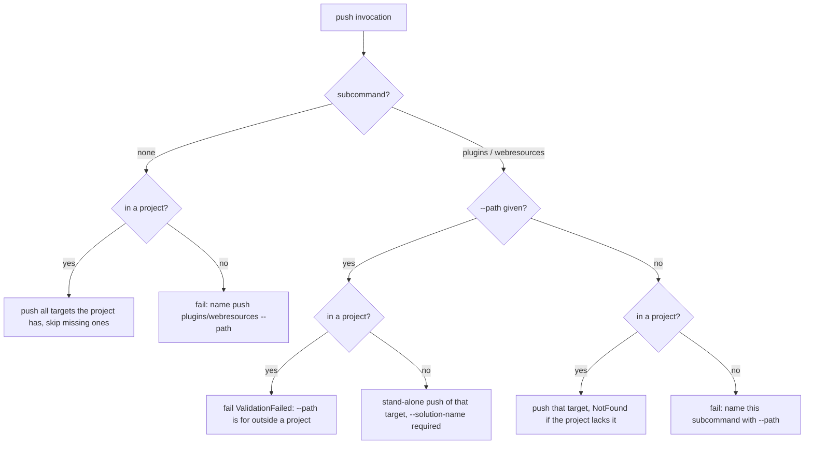

# Push Targets as Subcommands - Plan

## Goal Capsule

- **Objective:** Someone pushing to DEV, from a terminal, an agent or a CI pipeline outside a Flowline project, picks a target by name (`push plugins`, `push webresources`) and is offered only the flags that apply to that target. Bare `push` still pushes everything in the project.
- **Means:** `push` becomes a Spectre branch with a default command and two subcommands, with shared options declared on the branch settings (KTD1, KTD2). Stand-alone input is one `-p|--path` per subcommand (KTD4).
- **Authority:** This plan's Key Decisions and KTDs. `.claude/skills/cli-for-agents/SKILL.md` and `docs/tone-of-voice.md` govern flags and message wording. `docs/solutions/conventions/cli-surface-change-doc-sweep.md` governs the doc sweep.
- **Stop conditions:** Stop and ask if Spectre 0.57.2 in the real app does not bind a branch-declared option on both sides of the subcommand, if `push -h` does not list the branch options and both subcommands, or if `push --force <value> plugins` binds the value as anything other than the force value.
- **Execution profile:** One breaking change, one PR in this repo plus one commit in the wiki repo (`/home/remyduijkeren/Projects/Flowline.wiki`). Ask about the branch before the first commit (AGENTS.md, Branching).
- **Finishes the work:** `ce-work` or a human, in unit order.

---

## Product Contract

### Summary

`flowline push` becomes a command group. Bare `push` pushes every target the project has, as today. `push plugins` and `push webresources` (alias `wr`) push one target and carry that target's own flags. `--scope`, `--plugin-file` and `--webresources <PATH>` are removed. Stand-alone mode moves to `push plugins --path` and `push webresources --path`.

### Problem Frame

One flag today chooses what to push (`--scope`), two others say where a pre-built artifact comes from (`--plugin-file`, `--webresources`), and `assemblyonly` hides a third concern (how much of the plugin registration to push) inside the scope list (`src/Flowline/Commands/PushCommand.cs:40-50`, `:586-614`). In stand-alone mode the path flags already decide the scope, so `--scope` there is redundant at best. A path the scope excludes is silently ignored. Stand-alone users are mostly CI pipelines and developers who replace one step of their process, and the tools they know (PAC's `plugin push`, PACX's `plugin push` and `webresources push`) treat each target as its own command. PCF is a planned next target with its own flags, which a flat flag list would not absorb.

### Requirements

**Command surface**

- R1. `flowline push` with no subcommand pushes every target the project has, with today's behaviour, including skipping a target the project does not have.
- R2. `flowline push plugins` pushes only plugins. `flowline push webresources` and its alias `flowline push wr` push only web resources and form event handlers.
- R3. Options that apply to every target are accepted on bare `push` and on both subcommands, before or after the subcommand name: `-e|--env`, `-n|--solution-name`, `--dry-run`, `--no-build`, `--no-delete`, `-v|--verbose`, `-f|--force`, `--no-cache`, `-a|--auto-select-auth-profile`.
- R4. Target-only options exist only on their subcommand: `-p|--path` on both, `--assembly-only` on `push plugins`, `--no-publish` on `push webresources`. Bare `push` rejects them as unknown options.
- R5. `--force` on each command accepts exactly the hazards that command can hit: plugins takes `delete-orphans`, `recreate-assembly`, `config`, `all`. Web resources takes `delete-form-handlers`, `config`, `all`. Bare `push` takes all five.
- R6. `--scope`, `--plugin-file`, `-s`, `-w` and `--webresources <PATH>` on bare `push` fail with the parser's own "Unknown option" error and exit `ValidationFailed`.

**Stand-alone mode**

- R7. Outside a Flowline project, `push plugins --path <dll|nupkg> --solution-name <name>` and `push webresources --path <folder> --solution-name <name>` run stand-alone, with today's stand-alone behaviour for that target.
- R8. `--path` inside a Flowline project fails with `ValidationFailed` and a message saying `--path` is for use outside a project.
- R9. Outside a project, bare `push` and a subcommand without `--path` fail with a message naming the stand-alone form: the subcommand with `--path` and `--solution-name`.

**Explicit targets**

- R10. A subcommand names its target explicitly, so a project without that target is an error (`NotFound`), not a skip. Bare `push` keeps skipping a missing target with today's warning.

**Help and errors**

- R11. `flowline push -h` lists the shared options, both subcommands and at least one example per subcommand. Each subcommand's help lists its own options and examples, and `webresources` shows its alias.
- R12. A word after `push` that is not a subcommand keeps today's hint (`--solution-name` or `--env`). A near miss of a subcommand name (`push plugin`) gets Spectre's "Did you mean" suggestion instead.
- R13. Error messages, force-validation messages and logs name the command by its qualified canonical name (`push plugins`, and `push webresources` when `wr` was typed), not by the leaf alone.

**Documentation**

- R14. Help examples, README, shipped agent skills, repo docs that name the command, the wiki and CHANGELOG show only the new form. CHANGELOG records the removals under Breaking.

### Key Decisions

- **Subcommand per target.** (session-settled: user-directed — chosen over target flags with an optional path: the flat flag list does not scale to PCF and its own flags.) Governs R2, R4.
- **Bare `push` pushes everything.** (session-settled: user-directed — chosen over bare `push` showing help: keeps the one-word inner loop.) Governs R1.
- **Bare `push` takes only cross-cutting options plus every `--force` value.** (session-settled: user-approved — chosen over bare `push` taking the union of all subcommand flags: target tuning belongs on the target, and an approval must work on the command that hits the hazard.) Governs R3, R4, R5.
- **One `-p|--path` per subcommand.** (session-settled: user-directed — chosen over target-specific flag names and a positional path: one name for one concept, matching PACX.) Governs R4, R7.
- **Stand-alone is one target per call.** (session-settled: user-directed — chosen over pushing both targets in one stand-alone call: matches how PAC and PACX users already work.) Governs R7, R9.
- **`--path` stays refused inside a project.** (session-settled: user-directed — chosen over allowing it as an override of the project's build output.) Governs R8.
- **Old flags get the parser's error, no migration hint.** (session-settled: user-directed — chosen over a hint that prints the rewritten command.) Governs R6.
- **Names `plugins` and `webresources`, alias `wr`.** (session-settled: user-directed — chosen over PACX's singular `plugin`: matches `scaffold plugins`, the project folders and the old scope values, and Spectre suggests the right word on a slip.) Governs R2, R12.

### Scope Boundaries

- Non-goal: PCF or any other target. The branch shape leaves room, nothing is built for it.
- Non-goal: changing what any push does once the target is chosen: build, register, delete orphans, publish and form event registration run unchanged.
- Non-goal, considered and not built: a migration hint for the removed flags. User decision. Revisit if CI users report the break as hard to diagnose.
- Non-goal, considered and not built: a singular `plugin` alias. Spectre already answers "Did you mean 'plugins'?".

#### Deferred to Follow-Up Work

- A `docs/solutions/` learning on a branch with a default command, branch-declared shared options and command-name keying, once this lands (`ce-compound`).

### Sources

- Spectre 0.57.2 spike, machine-local and best effort: `/tmp/claude-1000/-home-remyduijkeren-Projects-Flowline/7ad5c5e5-eecf-4c59-8010-1f681f59fb4b/scratchpad/spike/Program.cs`. With strict parsing it showed a default command binding its own options, target-only flags rejected per subcommand, a typed branch's options binding before and after the subcommand, the alias reporting the full command name, and `push -h` listing branch options. A missing spike is not a blocker; this plan governs.
- `docs/plans/2026-09-06-1132-feat-configure-inline-component-plan.md:168` recorded on 0.55 that a branch option is ignored after the subcommand. The 0.57.2 spike contradicts it, so the stop condition re-checks it in the real app.
- PAC CLI `pac plugin push` (https://learn.microsoft.com/en-us/power-platform/developer/cli/reference/plugin), PACX command directory (https://github.com/neronotte/Greg.Xrm.Command/wiki/Command-Directory) and `pacx webresources push` (`-p|--path`, alias `wr`), and clig.dev on subcommand consistency and flags over arguments.

---

## Planning Contract

### Key Technical Decisions

- KTD1. **Typed branch with a default command.** Register `push` as a branch over a shared push settings base, set the push-everything command as its default, and add `plugins` and `webresources` (alias `wr`) as leaves. Leaf and default settings derive from the shared base, which derives from today's `SolutionNameSettings` so `--env` and `--solution-name` keep their single declaration. Registration order is default, plugins, webresources, because Spectre renders in registration order.
- KTD2. **Shared options on the branch settings, target options on the leaf settings.** Spectre then lists shared options in `push -h` and rejects a target option on the wrong command at parse time, with no hand-written check (R3, R4). This replaces the examples workaround: everything bare `push` accepts is a branch option.
- KTD3. **One engine, the target set comes from the command.** Keep a single push engine. The three commands are thin entry points that contain no push logic: each maps its own options to the targets it covers, whether the target was named explicitly, and its target options, then calls the engine. Bare `push` runs the engine once with both targets, so one environment resolve, one connection and one done line, as today. It never calls the subcommands in sequence. This replaces scope resolution and the `assemblyonly`/`plugins` exclusivity check (`PushCommand.cs:586-614`). Explicit targets carry the error rule in R10, and the existing "explicit scope" test at `PushCommand.cs:448` becomes "explicit target".
- KTD4. **Stand-alone is decided by `--path`, per subcommand.** A subcommand is stand-alone when `--path` is given, and the existing in-project refusal and solution-name requirement apply unchanged (R7, R8). Bare `push` is never stand-alone.
- KTD5. **The command name is resolved once in the shared command base.** Build the qualified name (`push`, `push plugins`, `push webresources`) where `context.Name` is read today (`src/Flowline/Commands/FlowlineCommand.cs:87`, `:121`, `:141-149`, `:186`) and use it for force validation, the runtime command name and the log lines (R13). The argument strip cannot prefix-match that name, because the typed line may hold an alias (`push wr`) or options before the subcommand (`push --dry-run plugins`). It drops the verb token and the subcommand or alias token wherever they sit, and keeps everything else. Fixing it in the base keeps every command right, `settings` included.
- KTD6. **The positional hint skips registered subcommand names and near misses.** `SolutionNameSettings.BuildPositionalHint` (`src/Flowline/Settings/SolutionNameSettings.cs:32-56`) returns no hint when the word after `push` is a push subcommand or alias, or a close match to one, so Spectre's own suggestion shows (R12). Read the names from one shared list, so a new subcommand cannot leave the hint stale.
- KTD7. **`push webresources` without a WebResources project is `NotFound`.** Today the explicit `--scope webresources` with no WebResources project only warns "Plugins are still pushed" (`PushCommand.cs:541-548`), which is wrong for a web-resources-only command. This aligns it with the plugin rule (R10).

### High-Level Technical Design

Which options each command accepts, after the change:

| Option | `push` | `push plugins` | `push webresources` / `wr` | Declared on |
|---|---|---|---|---|
| `-e`, `-n`, `--dry-run`, `--no-build`, `--no-delete`, `-v`, `--no-cache`, `-a` | yes | yes | yes | branch |
| `-f\|--force` | all five values | plugins values | web resources values | branch (values checked per command, R5) |
| `-p\|--path` | no | yes | yes | leaf |
| `--assembly-only` | no | yes | no | leaf |
| `--no-publish` | no | no | yes | leaf |

How the mode is decided:

### Sequencing

U1 creates the command shape everything else builds on. U2 moves the engine onto it. U3 and U4 are independent of each other and depend on U1. U5 and U6 come last, once the surface is final.

---

## Implementation Units

### U1. Push branch, settings and registration

**Goal:** `push` parses as a branch with a default command and two subcommands, with options declared per KTD1 and KTD2.

**Requirements:** R1, R2, R3, R4, R6, R11

**Dependencies:** none

**Files:**
- `src/Flowline/Commands/PushCommand.cs`
- `src/Flowline/Settings/SolutionNameSettings.cs` (only if the shared base needs a hook)
- `src/Flowline/Program.cs` (registration and examples, `:435-439`, root example `:418`)
- `src/Flowline/Properties/launchSettings.json`
- `tests/Flowline.Tests/ProgramParsingTests.cs`
- `tests/Flowline.Tests/PushCommandTests.cs`

**Approach:**
1. Split the current settings into a shared base (branch options) and three settings classes: default (no extra options), plugins (`--path`, `--assembly-only`), webresources (`--path`, `--no-publish`).
2. Remove `--scope`, `--plugin-file` and `--webresources`. Remove the scope enum once U2 no longer needs it.
3. Register the branch per KTD1, with examples on the branch and each leaf, and keep the root `push` example.
4. Replace the two `--scope` launch profiles with `push plugins` and `push webresources` profiles.

**Patterns to follow:** the `settings` branch registration in `src/Flowline/Program.cs:504-551`, the alias precedent on `scaffold` (`:555-558`), and the shared option constants in `SolutionNameSettings`.

**Test scenarios:**
- `push --dry-run -e dev` routes to the default command with both options bound.
- `push plugins --dry-run` and `push --dry-run plugins` both bind `--dry-run` on the plugins command.
- `push wr -p ./dist --no-publish` routes to webresources with path and no-publish bound.
- `push --force delete-orphans plugins` binds `delete-orphans` as the force value and routes to plugins.
- `push --assembly-only`, `push --no-publish` and `push -p x` exit `ValidationFailed`.
- `push plugins --no-publish` and `push wr --assembly-only` exit `ValidationFailed`.
- `push --scope plugins`, `push --plugin-file x.dll` and `push --webresources ./dist` exit `ValidationFailed`.
- Debug example validation passes for every registered example.

**Verification:** the parse probes pass, and a Release build's `push -h`, `push plugins -h` and `push wr -h` match R11.

### U2. Engine routing by target

**Goal:** Each command runs the existing push engine for its own targets, stand-alone is keyed on `--path`, and explicit targets follow R10.

**Requirements:** R1, R2, R5, R7, R8, R9, R10

**Dependencies:** U1

**Files:**
- `src/Flowline/Commands/PushCommand.cs`
- `src/Flowline.Core/Plugins/PluginService.cs` (messages at `:81`, `:90` naming `--scope assemblyonly`)
- `src/Flowline.Core/Plugins/PluginProjectResolver.cs` (`:179` names `push --plugin-file <dll>`)
- `tests/Flowline.Tests/PushCommandTests.cs`
- `tests/Flowline.Tests/ReviewFixRegressionTests.cs` (stand-alone detection test at `:121`)

**Approach:**
1. Replace scope resolution with the target set and explicit flag from KTD3. Assembly-only is a plugins option, not a target.
2. Key stand-alone detection on `--path` (KTD4) and keep the in-project refusal and solution-name rule, reworded for `--path`.
3. Give each command its own force vocabulary per R5.
4. Make the missing-WebResources-project case `NotFound` for the explicit target (KTD7). Keep the bare-push warning.
5. Add the R9 messages for a run outside a project with no `--path`. The base class's generic "No Flowline project found" must not win for push commands.
6. Reword every message that names a removed flag to name the new form.

**Execution note:** start with characterization tests of today's per-scope behaviour (which targets run, which warnings print) so the routing change shows no drift in what a push does.

**Patterns to follow:** the stand-alone rules in `PushCommand.cs:583-628`, `SettingsSupport.ResolveStandalone` for keying mode on a flag plus no project, and messages per `docs/tone-of-voice.md`.

**Test scenarios:**
- Bare push in a project with plugins and web resources prepares both targets.
- Bare push in a web-resources-only project skips plugins without an error.
- `push plugins` in a project with no plugin project fails `NotFound`.
- `push webresources` in a project with no WebResources project fails `NotFound`.
- `push plugins --assembly-only` takes the assembly-only path. A `.nupkg` still takes the package path, as today.
- `push plugins -p x.dll -n Contoso` outside a project runs stand-alone with that dll.
- `push plugins -p x.dll` inside a project fails `ValidationFailed` with the `--path` message.
- `push plugins -p x.dll` outside a project without `-n` fails with today's solution-name message.
- Bare push outside a project fails and the message names `push plugins --path` and `push webresources --path`.
- `push wr --force recreate-assembly` fails force validation and lists the web resources values.
- `push --force delete-form-handlers` passes validation.
- `push wr --no-publish` prints the publish skip line, as `--no-publish` does today.

**Verification:** PushCommand and regression tests pass. `rg` finds no message in `src/` naming `--scope`, `--plugin-file`, `--pluginFile`, `assemblyonly` or `--webresources` as a flag.

### U3. Qualified command name in the shared base

**Goal:** Messages and logs name the command as typed (R13).

**Requirements:** R13

**Dependencies:** U1

**Files:**
- `src/Flowline/Commands/FlowlineCommand.cs`
- `tests/Flowline.Tests/FlowlineSettingsTests.cs` or a focused test beside existing force-validation tests

**Approach:** Resolve the qualified name once per KTD5 and use it at every site that reads `context.Name` today. Check whether Spectre exposes the parent branch on the command context. If it does not, derive the name from the raw arguments or the settings type, and record which in the code.

**Test scenarios:**
- Force validation on `push plugins --force bogus` names `push plugins` in its message.
- The invocation log line for `push wr --dry-run` names `push webresources` and logs `--dry-run` with no repeated command words.
- The invocation log line for `push --dry-run plugins` names `push plugins` and logs `--dry-run` with no repeated command words.
- `deploy` keeps naming itself `deploy`.
- `settings toggle` now names itself `settings toggle` in its log line and force-validation message. Today it shows only `toggle`, because a branch leaf's context name is the leaf alone (seen in the spike).

**Verification:** tests pass and a Release run of `push plugins --force bogus` shows the qualified name.

### U4. Positional hint respects subcommands

**Goal:** The positional hint stays for real stray words and stays out of the way of subcommand names and near misses (R12).

**Requirements:** R12

**Dependencies:** U1

**Files:**
- `src/Flowline/Settings/SolutionNameSettings.cs`
- the test file that covers `BuildPositionalHint` today in `tests/Flowline.Tests/`

**Approach:** Apply KTD6. Expose the push subcommand names and alias from the place U1 registers them, so the hint and the registration share one list.

**Test scenarios:**
- `push Contoso` still returns the `--solution-name` hint.
- `push dev` still returns the `--env` hint.
- `push plugins --bogus` returns no positional hint.
- `push plugin` returns no positional hint, so Spectre's "Did you mean 'plugins'?" shows.
- `generate Contoso` is unchanged.

**Verification:** hint tests pass. A Release run of `push plugin` shows Spectre's suggestion.

### U5. Repo doc sweep and CHANGELOG

**Goal:** Every doc surface in this repo shows only the new form (R14).

**Requirements:** R14

**Dependencies:** U1, U2

**Files:**
- `README.md`
- `CHANGELOG.md` (Unreleased, Breaking)
- `plugin/skills/flowline/SKILL.md`, `plugin/skills/flowline-plugins/SKILL.md`, `plugin/skills/flowline-webresources/SKILL.md`, `plugin/skills/flowline-migration/SKILL.md`
- `.claude/skills/cli-for-agents/SKILL.md`
- `AGENTS.md` (stand-alone hint at `:190` still names `push --pluginFile <dll>`)
- `docs/folder-structure.md`, `docs/end-to-end-test-goal.md`

**Approach:** Follow `docs/solutions/conventions/cli-surface-change-doc-sweep.md`. Run the literal search over all surfaces, then a prose search for the concepts ("scope", "plugin file", "assembly only", "web resources folder"). Leave dated records alone, `docs/end-to-end-test-log.md` included. The CHANGELOG entry lists each removed flag with its replacement and says the target is now a subcommand.

**Test expectation:** none -- documentation only. The search output is the evidence.

**Verification:** the closing search returns no stale spelling outside dated records, and its output is quoted in the final report.

### U6. Wiki sweep

**Goal:** The wiki shows only the new form (R14).

**Requirements:** R14

**Dependencies:** U5

**Files (wiki repo `/home/remyduijkeren/Projects/Flowline.wiki`):**
- `04-Command-Reference.md`, `05-Push-Plugins-and-Custom-APIs.md`, `06-Push-WebResources.md`, `10-WebResources-Project.md`, `02-Project-Configuration.md`
- `16-Migration-from-spkl.md`, `17-Migration-from-Daxif.md`, `18-Migration-from-ALM-Accelerator.md`, `19-Migration-from-PACX.md`
- any other page the closing search hits (`01`, `03`, `07`, `08`, `12` mention push today)

**Approach:** Read the wiki's `AGENTS.md` first. In the PACX migration page, map `pacx plugin push --path` to `flowline push plugins --path` and `pacx wr push` to `flowline push wr`. Commit in the wiki repo separately. Do not push it without approval.

**Test expectation:** none -- documentation only.

**Verification:** the literal search over the wiki returns no stale spelling, quoted in the final report.

---

## Verification Contract

- Build: `dotnet build Flowline.slnx` in Debug, so Spectre validates every example.
- Tests: `dotnet test tests/Flowline.Tests/Flowline.Tests.csproj` while iterating, then `dotnet test Flowline.slnx` before done, because U3 touches the shared command base.
- Release checks (`-c Release`, per AGENTS.md): `push -h`, `push plugins -h`, `push wr -h`, `push --scope plugins`, `push --assembly-only`, `push plugin`, and `push plugins --force bogus`. Check wording against `docs/tone-of-voice.md`, and run `/tone` if available.
- Doc sweep: the literal and prose searches from U5 and U6, with output kept for the report.

## Definition of Done

- R1 to R14 hold and each has a passing test or quoted search output.
- Stop conditions in the Goal Capsule were checked against the real app, not only the spike.
- No dead code from the removed scope, plugin-file or web-resources-path options, and no comments that describe them as current.
- The full test suite passes. The final report lists what was verified and what was not.
- The wiki change is committed in its own repo and not pushed without approval.
