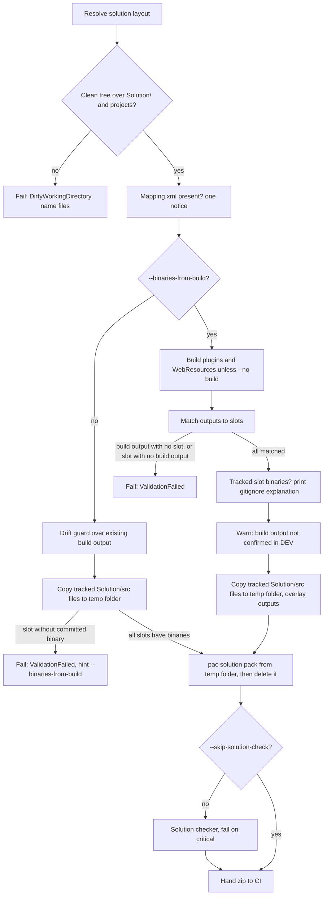

# Pack Command - Plan

## Goal Capsule

- **Objective:** A team can produce the exact packed solution it ships or promotes, solution checked, from Flowline alone, without a target environment and without calling `pac solution pack` or keeping a mapping file.
- **Source issue:** https://github.com/RemyDuijkeren/Flowline/issues/24.
- **Means:** one shared pack path behind a new `pack` command and `deploy`, with an opt-in `--binaries-from-build` that lays fresh binaries over a temporary copy of the committed slots (KTD2, KTD4, KTD5).
- **Product authority:** the Product Contract below wins on behavior; the Planning Contract wins on mechanism within it.
- **Execution profile:** one PR, on its own branch (`/ce-work` sets up the branch and worktree, per `AGENTS.md`).
- **Stop conditions:** stop and ask if a requirement turns out infeasible against `pac solution pack`, or if the shared pack path cannot keep deploy's import behavior unchanged apart from R16 and R18. U9's first proof is that a pack from the staged folder gives the same zip as today's pack from `Solution/src` on a normal repo; stop and ask if it does not.
- **Finishes the work:** the executor, through `/ce-work`; the user ships.
- **Open blockers:** None.

---

## Product Contract

### Summary

A new `flowline pack` command packs the committed `Solution/src` into one packed solution (zip) without connecting to any target environment, and runs the solution checker on it. A `--binaries-from-build` flag on both `pack` and `deploy` packs from a temporary copy of the solution with fresh plugin and web resource build output laid over it, so the working tree is never touched. Deploy packs through the same path and loses its artifact cache.

### Problem Frame

For ISV work the deliverable is a packed solution handed to a customer, not a deploy. Flowline only packs inside `deploy`, and `deploy` needs a live target: `<target>` is a required argument and the DTAP gate and target-existence check run before packing (`src/Flowline/Commands/DeployCommand.cs:31`, `:162`).

The SpotlerAutomate ISV pipeline therefore drops out to raw PAC. Its Nuke build compiles, then runs `pac solution pack --map Mapping.xml --packagetype Both`, mapping the plugin DLLs from `bin/Release` and `WebResources/dist/**` into the zip. That is the mapping-file setup Flowline deliberately does not support, and it leaves CI half Flowline, half hand-written PAC calls.

Issue 24 set a bar: the command earns its place only if it does more than wrap `pac solution pack`. With committed-snapshot packing alone, only "same artifact as deploy" and "solution checker without a target" hold. `--binaries-from-build` is in scope to clear that bar.

### Key Decisions

- **New `pack` command, not a deploy mode.** A deploy without a target contradicts deploy's required argument and collides with `--dry-run`, and every target-only deploy flag would be invalid in that mode. Governs R1, R2. (session-settled: user-directed, chosen over extending `deploy` with an optional target or `--pack-only`, and over documenting `pac solution pack` only: the ISV pipeline should not drop out to PAC, and `--binaries-from-build` needs a home that does not bloat deploy.)
- **Committed snapshot is the default; `--binaries-from-build` is an add-on.** Governs R1, R9. (session-settled: user-directed, chosen over making build output the only source: the Flowline model commits binaries through `pull`, and that stays the baseline.)
- **One zip per `.flowline`.** Governs R3. (session-settled: user-directed, chosen over a flag or default that writes both managed and unmanaged: unclear it is worth adding, cheap to add later.)
- **Version from `Solution.xml` as committed.** Governs R4. (session-settled: user-directed, chosen over a version override flag or reading the git tag: not needed now.)
- **Solution checker on by default, skippable.** Governs R6. (session-settled: user-directed, chosen over opt-in or never: catches failures at PR time instead of release day.)
- **Clean git tree before `pack` and `deploy`, no exceptions.** Governs R8. (session-settled: user-directed, chosen over exempting slot files from the clean check under `--binaries-from-build`: one rule is simpler than a special case.)
- **`--binaries-from-build` stages in a temporary copy of `Solution/src`.** Governs R11. (session-settled: user-directed, chosen over overwriting tracked slot files and restoring them with git, and over refusing to run until slots are gitignored: the working tree is never written, so there is no restore step, no interrupted-run cleanup, and no build output left behind in ignored slots.)
- **A slot with no build output is an error.** Governs R10. (session-settled: user-directed, chosen over packing the committed file with a warning: every binary under `--binaries-from-build` comes from the build. Accepted cost: a web resource added only in Dataverse, or an assembly with no local project, blocks `--binaries-from-build` until it is brought into source.)
- **`deploy --binaries-from-build` is in scope.** Governs R15. (session-settled: user-directed, chosen over deferring it: a local deploy from fresh output should not need a separate pack step.)
- **Versioned zip name from both commands.** Governs R18. (session-settled: user-directed, chosen over unversioned everywhere and over versioning only `pack`'s file: with the cache gone nothing depends on a fixed name, one shared pack path should produce one name, and a zip handed to a customer must show its version.)
- **`--binaries-from-build` skips the drift guard and warns once.** Governs R19. (session-settled: user-directed, chosen over keeping the guard, which would block every real change, and over keeping it on deploy only: the flag is the explicit opt-out from "deploy only what DEV confirmed".)
- **The flag is named `--binaries-from-build`.** Governs R9, R15. (session-settled: user-directed, chosen over `--from-build`, which reads as a whole-solution cdsproj build, over `--code-from-build`, which suggests PCF code components, and over `--use-build-output` and `--binaries <committed|build>`: the name has to say that only binaries change and the rest stays the committed snapshot.)
- **Pack the commit, not the folder.** Governs R1, R11, R20. (session-settled: user-directed, chosen over packing `Solution/src` as it sits on disk: ignored files pass the clean-tree check, so the same commit could produce different zips on a laptop and on CI.)
- **Remove deploy's artifact cache.** Governs R16. (session-settled: user-approved, chosen over keeping it: it only saves a repack for same-commit multi-environment deploys on one machine, rarely hits on CI, and `pack` plus `deploy --path` gives the same-zip guarantee explicitly.)

### Requirements

**Pack command**

- R1. `flowline pack` packs `Solution/src` as committed at the current commit (HEAD), not the folder on disk, into a packed solution, and never connects to a target environment.
- R20. Without `--binaries-from-build`, a slot whose metadata is committed but whose binary is not fails the pack, naming the slot and pointing at `--binaries-from-build`.
- R2. `deploy --path` accepts the zip `pack` writes, so CI packs once and every environment imports the same file.
- R3. `pack` writes one zip, managed or unmanaged as `.flowline` sets, the same type `deploy` would import.
- R4. The zip carries the solution version from the committed `Solution.xml`; `pack` never changes the version.
- R5. `pack` writes to `artifacts/` next to the solution by default; `--output <dir>` sets another folder.
- R6. `pack` runs the solution checker on the zip and fails on critical findings, using deploy's rule; `--skip-solution-check` skips it.
- R7. On CI, `pack` hands the zip to the pipeline the way `deploy` does (Azure DevOps artifact upload, GitHub Actions step output).
- R8. `pack` requires a clean git tree over the same inputs deploy checks, and runs deploy's local drift guard over whatever build output already exists, so a committed binary that differs from its source build fails as it does on deploy.
- R14. When a `Mapping.xml` or `solution-mapping.xml` sits next to the solution, `pack` says once that Flowline does not read it and that `--binaries-from-build` replaces it.

**`--binaries-from-build`**

- R9. `--binaries-from-build` builds the plugin and web resource projects resolved from the solution file, the same way `push` does, and `--no-build` uses existing build output instead.
- R10. Each build output is matched to its existing slot in `Solution/src`; a build output with no slot fails with the `push` then `pull` fix, and a slot with no build output fails naming the slot.
- R11. `--binaries-from-build` overlays the build output on the same committed copy R1 packs, in a temporary folder, and packs from that folder; the working tree is not modified and the temporary folder is removed afterwards.
- R13. When slot binaries are tracked in git, `--binaries-from-build` says the build makes those committed copies redundant, explains the `.gitignore` alternative, prints the example block, and says that after adopting it every `pack` and `deploy` needs `--binaries-from-build` (R20).
- R19. Under `--binaries-from-build`, `pack` and `deploy` skip the drift guard and print one warning that the zip contains build output not confirmed in DEV.

**Deploy**

- R15. `deploy --binaries-from-build` packs through the same path as `pack --binaries-from-build`, with the same rules (R9 to R11, R13, R19), before its existing pre-import checks and import.
- R16. `deploy` packs fresh on every run; the artifact cache, its manifest, and its reuse messages are removed, and `--no-cache` stays for the pre-flight checks cache other commands use.
- R17. `deploy` and `pack` produce the zip through one shared pack path, so the same source gives the same zip from either command.
- R18. Both commands name the zip `<UniqueName>_<major>_<minor>_<build>_<revision>_managed.zip` (or `_unmanaged.zip`) from the `Solution.xml` version, and never delete older zips in the output folder.

### Acceptance Examples

- AE1. **Covers R1, R6, R7.** Given a clean checkout on a CI runner with a PAC login and no target configured, when `flowline pack` runs, then a managed zip lands in `artifacts/`, the solution checker passes, and the pipeline receives the zip path.
- AE2. **Covers R2.** Given the zip from AE1 downloaded in a later stage, when `flowline deploy prod --path <zip>` runs, then that same file is imported.
- AE3. **Covers R10.** Given a solution whose `Solution/src` has a web resource added in Dataverse with no file in `WebResources/dist`, when `pack --binaries-from-build` runs, then it fails naming that web resource and nothing is copied.
- AE4. **Covers R10.** Given a new plugin assembly that builds but has never been pushed and pulled, when `pack --binaries-from-build` runs, then it fails with the `push` then `pull` fix.
- AE5. **Covers R11, R13.** Given a Flowline repo where `pull` committed the plugin DLL, when `pack --binaries-from-build` runs, then it prints the `.gitignore` explanation, the zip holds the freshly built DLL, and `git status` shows no changes.
- AE6. **Covers R11.** Given a `pack --binaries-from-build` killed while packing, when `deploy test` runs next, then the clean-tree check passes, because the working tree was never modified.
- AE8. **Covers R1.** Given a clean checkout where an ignored file sits inside a plugin slot folder next to its committed DLL, when `flowline pack` runs, then the staged folder and the zip contain only the committed files.
- AE9. **Covers R20.** Given a repo on the `.gitignore` model (slot metadata committed, DLL ignored), when `flowline pack` runs without `--binaries-from-build`, then it fails naming the slot and `--binaries-from-build`, on a laptop with the ignored DLL present and on a fresh CI checkout alike.
- AE7. **Covers R16.** Given two `deploy` runs to `test` then `uat` from the same commit, when the second runs, then it packs again; `--no-cache` on `pull` still bypasses the pre-flight cache.

### Scope Boundaries

- Writing both managed and unmanaged zips in one run.
- A version override flag, or versioning from the git tag.
- Reading or supporting `--map` / mapping files in `pack`, `deploy` or `pull`.
- Adding the `.gitignore` block during `clone` or `scaffold`; it appears only in the R13 message.
- Running target-dependent checks (missing components, orphans, plugin package assemblies) at pack time; they need the target environment.
- A flag to drop the version from the file name; CI already receives the exact path (R7), so add it only when someone needs a fixed path.
- Changing the validation zips `pull`, `clone` and `init` write (`src/Flowline/Utils/PacUtils.cs:171-176`); they keep their unversioned names in `artifacts/`.
- Building plugin or web resource projects in plain `pack`; on a fresh checkout its drift guard has nothing to compare, as deploy's does today.
- Updating the `flowline-migration` skill for mapping-file repos; a candidate follow-up.

### Sources / Research

- `src/Flowline/Commands/DeployCommand.cs:31` required `<target>`; `:166`, `:605-608` artifact path; `:187-301`, `:612-676` artifact cache (removed by R16); `:684-687` why the name was fixed; `:310-311`, `:684-694` CI hand-off; `:571-577` clean-check and cache input paths; `:797-818` deploy's pack.
- `src/Flowline/Utils/PacUtils.cs:340-355` solution checker runs without `--environment` when none is given.
- `src/Flowline/Commands/PushCommand.cs:359-366` Release build per project and `--no-build`.
- `src/Flowline.Core/Deploy/PluginWebResourceDriftChecker.cs:62-143` drift categories, including web resources added in Dataverse and assemblies with no local source; `src/Flowline/Commands/PullCommand.cs:153-156` pull's warnings for them.
- `src/Flowline/Settings/DataverseSettings.cs:18-20` `--no-cache` is shared across Dataverse commands.
- SpotlerAutomate.Dataverse `build/Build.cs:214-224` and `src/Solution/Mapping.xml`: the mapping-file pipeline this replaces.
- https://remyduijkeren.com/writing/you-dont-need-a-solution-mapping-file/ for why mapping files are out of scope.

---

## Planning Contract

Product Contract preservation: changed, all user-directed in planning or review: R8 qualified to existing build output; R19 added (drift guard skipped under `--binaries-from-build`); R11 and R13 rewritten for temporary-copy staging and R12 removed (no restore step remains), with AE5 and AE6 updated; R14 moved to the Pack group; R1 tightened to the committed tree at HEAD and R20 added (cross-model review); the flag renamed to `--binaries-from-build`; Outstanding Questions resolved into KTDs and Scope Boundaries.

### Key Technical Decisions

- KTD1. **`pack` settings derive from `DataverseSettings`.** It needs `--force drift` (drift guard escape) and `--no-cache`, and `InitializeRuntimeOptions` only reads those from that base (`src/Flowline/Commands/FlowlineCommand.cs:72-78`). Valid force specifiers are `drift` only, as deploy restricts its own (`src/Flowline/Commands/DeployCommand.cs:99-100`). Fix the stale "every command that touches Dataverse" comment in `src/Flowline/Settings/DataverseSettings.cs`. Governs R1, R8.
- KTD2. **One pack service in `Flowline`, built from extracted deploy pieces.** A new `src/Flowline/Services/SolutionPackService.cs` owns: the versioned zip path (R18), the `pac solution pack` call (replacing deploy's private pack), the clean-tree check and drift guard with command-neutral wording, and the CI hand-off. `pack` and `deploy` both call it; deploy keeps its own step order and only swaps implementations. It lives in `Flowline` because it launches `pac` and `git` (`AGENTS.md` boundary rule). Governs R7, R8, R16, R17, R18.
- KTD3. **Solution checker without a target goes straight to the checker call.** `pack` calls the checker with no environment (`src/Flowline/Utils/PacUtils.cs:340-355`) and reuses the critical-finding rule now in `src/Flowline/Services/SolutionCheckService.cs:25`, extracted so both callers throw the same `ValidationFailed` message. Deploy keeps running it as a pre-import service. Governs R6.
- KTD4. **Slot matching is pure logic in Core, keyed on metadata files.** A new `src/Flowline.Core/Deploy/BuildOutputSlotMatcher.cs` reads `Solution/src` and returns a copy plan, unmatched build outputs and slots without output. Slots are found by their metadata, never by an existing binary, because the `.gitignore` model commits only the metadata (`SpotlerAutomate.Dataverse/src/Solution/src/PluginAssemblies/*/…dll.data.xml`). Keys:
  1. Classic assembly: the simple name in `<dll>.data.xml` `FullName`, using the reader the drift checker already has (`src/Flowline.Core/Deploy/PluginWebResourceDriftChecker.cs:158-186`), made shared.
  2. Plugin package: `pluginpackages/<dir>/pluginpackage.xml` `uniquename` minus the publisher prefix, matched to the project's assembly name (`src/Flowline.Core/Plugins/PluginPackageContentReader.cs:36-43`, naming at `PluginService.cs:392`).
  3. Web resource: `<Name>` in the slot's `.data.xml`, compared case-insensitively with the name `push` would give the `dist/` file (`src/Flowline.Core/WebResources/WebResourceReader.cs:400-431`), with the publisher prefix taken from the slot folder instead of Dataverse.
  Governs R10.
- KTD5. **Every pack stages the tracked files of `Solution/src` in a temporary folder; the working tree is read-only.** List the files git tracks under `Solution/src` and copy exactly those from disk into a per-run folder under the system temp directory. The clean-tree check (R8) guarantees they equal HEAD, in the same checked-out form `pac` reads today, so line endings, filters and LFS behave as now; ignored and untracked files never enter the folder. Without `--binaries-from-build`, check the tracked-file list for slots without a binary (R20); with the flag, skip that check and overlay the KTD4 copy plan instead. Then pass the folder to `pac solution pack --folder`. `pac` reads the unpacked folder only and needs no `.cdsproj` ([pac solution pack](https://learn.microsoft.com/power-platform/developer/cli/reference/solution#pac-solution-pack)); for the YAML layout Microsoft documents that missing component paths are skipped with a warning, so R20 must run before `pac`. Remove the folder in a finally path; a folder left by a crash is harmless and never inside the repo. One new git helper lists tracked files under a path; it serves staging, the R20 check and the R13 message. Under `--binaries-from-build` the clean-tree scope widens from the plugin and WebResources project files to their whole project folders, so uncommitted source cannot be compiled into the zip (build output folders are gitignored and stay out of it). Governs R1, R11, R13, R20.
- KTD6. **Exit codes follow `src/Flowline.Core/ExitCode.cs`.** A build output with no slot and a slot with no build output (under the flag), and a slot without a committed binary (R20, no flag), all exit `ValidationFailed` (15); a failed build or missing build output under `--no-build` `BuildFailed` (13), a dirty tree `DirtyWorkingDirectory` (12), a failed pack `BuildFailed` as deploy's pack does today. A failure to delete the temporary folder is logged at verbose level and never changes the exit code. Governs R10, R11.
- KTD7. **Build reuses push's per-project build.** Extract push's Release build of each plugin project and the WebResources project, with `--no-build` and the stale-package handling, from `src/Flowline/Commands/PushCommand.cs:350-440` into a shared helper both push and the pack service call. Governs R9.
- KTD8. **Deploy runs the offline pack checks early and packs at the existing pack step.** The R20 check (against the tracked-file list, not a staged folder) and, under `--binaries-from-build`, the build and slot match (R9, R10) run beside the clean-tree check, before target checks and connect, so they fail fast. Staging from the same tracked-file list, the overlay and pack stay where deploy packs today (after connect, before backup, solution check and import, `src/Flowline/Commands/DeployCommand.cs:275-302`). `--binaries-from-build` with `--path` is rejected before any work, since `--path` supplies a finished zip. The commit lookup at `:189` stays, because the provenance note and tag hint use it (`:341`, `:370`). Governs R15, R16, R20.
- KTD9. **The zip name comes from `Solution.xml`.** Dots in the version become underscores; the managed suffix follows `.flowline`. The Azure DevOps artifact name stays `<UniqueName>-<version>` (`src/Flowline/Commands/DeployCommand.cs:688-689`). Governs R18.

### High-Level Technical Design

Flow of one `pack` run, both modes. Every mode stages the tracked files into a temporary folder; `--binaries-from-build` adds the build, match and overlay. Deploy runs the same checks before connecting and stages at its pack step (KTD8).

| Command | Clean tree | Drift guard | Stage tracked files | Build and overlay | Checker | CI hand-off |
|---|---|---|---|---|---|---|
| `pack` | yes | yes | yes | no | yes, skippable | yes |
| `pack --binaries-from-build` | yes | skipped, warns | yes | yes | yes, skippable | yes |
| `deploy` | yes | yes | yes, at pack step | no | pre-import service | yes, not on `--dry-run` |
| `deploy --binaries-from-build` | yes | skipped, warns | yes, at pack step | yes, before connect | pre-import service | yes, not on `--dry-run` |

### Assumptions

- `pac solution pack --folder` accepts a folder outside the repository: Microsoft documents `--folder` as the folder packing reads from, and the existing call passes only `--folder`, `--zipFile` and `--packageType` (`src/Flowline/Commands/DeployCommand.cs:797-818`). U9 proves it first (Goal Capsule stop condition).
- In plugin-package mode the unpacked solution has no `PluginAssemblies/` entries; the slot is `pluginpackages/<uniquename>/pluginpackage.xml` plus `package/<uniquename>.nupkg` (verified in a sibling repo, `ROVM/Solution/src/pluginpackages/dwe_DWE_Base.Plugins/`). A built `<PackageId>.<version>.nupkg` is copied under the slot's file name.
- Copying the tracked files once per run costs little next to the pack it feeds.

---

## Implementation Units

### U1. Shared pack path, versioned name, cache removal

**Goal:** Deploy packs through the shared service into the versioned zip name and no longer caches.

**Requirements:** R16, R17, R18; KTD2, KTD8, KTD9.

**Dependencies:** none.

**Files:**
- `src/Flowline/Services/SolutionPackService.cs` (new)
- `src/Flowline/Commands/DeployCommand.cs`
- `src/Flowline/Program.cs` (service registration, deploy description at `:527`)
- `tests/Flowline.Tests/SolutionPackServiceTests.cs` (new)
- `tests/Flowline.Tests/DeployCommandArtifactCacheTests.cs` renamed to `tests/Flowline.Tests/DeployCommandInputPathTests.cs`, keeping only the input-path tests
- `tests/Flowline.Tests/DeployCommandCacheMessagingTests.cs` (delete)
- `tests/Flowline.Tests/DeployCommandCiArtifactTests.cs`

**Approach:**
1. Add the versioned path builder and a throwing `pac solution pack` call that takes the source folder and zip path to the new service; deploy's private pack goes.
2. Delete the cache: manifest read and write, outcome enum, status messages, the `--no-cache` read at `:191`, the log field, and the comments that call the name load-bearing (`:560-561`, `:684-687`, `:306-318`, `:577-578`).
3. The DTAP gate version always comes from `Solution.xml` on the packed route.

**Patterns to follow:** `internal static` pure helpers tested directly, as in `DeployCommandCiArtifactTests.cs`.

**Test scenarios:**
- Version `1.2.0.0`, unmanaged: name is `<Name>_1_2_0_0_unmanaged.zip`.
- Version `3.1.1.3`, managed: name is `<Name>_3_1_1_3_managed.zip`.
- `--output` folder given: path is inside that folder; default is `artifacts/` next to the solution.
- An older versioned zip in the folder is left in place after a new pack path is resolved.
- Input-path tests still pass unchanged in their renamed file.
- Covers AE7. Two deploy runs to `test` then `uat` from the same commit: the second run packs again.
- CI artifact line builders produce the same lines for a versioned path.

**Verification:** no reference to the artifact cache remains in `src/` or `tests/`; deploy tests pass.

### U2. Command-neutral guards and checker rule

**Goal:** The clean-tree check, drift guard, CI hand-off and checker fail rule can be called from `pack` with wording that fits either command.

**Requirements:** R6, R7, R8; KTD2, KTD3.

**Dependencies:** U1.

**Files:**
- `src/Flowline/Services/SolutionPackService.cs`
- `src/Flowline/Services/SolutionCheckService.cs`
- `src/Flowline/Commands/DeployCommand.cs`
- `tests/Flowline.Tests/SolutionPackServiceTests.cs`
- `tests/Flowline.Tests/PacUtilsCheckSolutionTests.cs` (extracted fail rule)

**Approach:**
1. Move the clean-tree check (`DeployCommand.cs:546-558`) and its input paths into the service, with the command name as a parameter.
2. Move the drift guard call and messages (`:579-603`) likewise.
3. Move the CI hand-off (`:698-725`) and its line builders; update test references.
4. Extract the critical-finding check and message from `SolutionCheckService` into a shared static both callers use.

**Patterns to follow:** message style in `docs/tone-of-voice.md`; `FlowlineException(ExitCode, message)`.

**Test scenarios:**
- Clean-tree message for `pack` says "pack", for `deploy` says "deploy"; both name up to three paths plus a count.
- Drift guard message names the command running it.
- Checker rule: zero critical findings passes; one critical finding throws `ValidationFailed` naming the report folder.

**Verification:** deploy behaviour and exit codes unchanged apart from wording; a Release build of `deploy --dry-run` shows the same checks.

### U3. `flowline pack` command

**Goal:** `flowline pack` packs the committed snapshot with no target, checks it, and hands it to CI.

**Requirements:** R1 to R8, R14, R20; KTD1, KTD3; covers AE1, AE2, AE8, AE9.

**Dependencies:** U1, U2, U9.

**Files:**
- `src/Flowline/Commands/PackCommand.cs` (new)
- `src/Flowline/Program.cs` (registration after `deploy`, description, examples)
- `src/Flowline/Settings/DataverseSettings.cs` (comment)
- `tests/Flowline.Tests/PackCommandTests.cs` (new)
- `tests/Flowline.Tests/FlowlineSettingsTests.cs`

**Approach:**
1. Settings in this unit: `--output <dir>` and `--skip-solution-check`. `--binaries-from-build` and `--no-build` arrive in U6 with the staging code.
2. Order: layout, clean tree, `Mapping.xml` notice, drift guard, staged pack (U9), checker, CI hand-off, final line naming the zip.
3. `Mapping.xml` or `solution-mapping.xml` (the two names issue 24 uses) in the Dataverse solution folder, beside the cdsproj, matched case-insensitively, gives one info line (R14).
4. When the checker cannot run, the existing PAC-login message (`src/Flowline/Utils/PacUtils.cs:370`) also names `--skip-solution-check` for `pack`.
5. Follow `.claude/skills/cli-for-agents/SKILL.md` for flags, exit codes and help text.

**Patterns to follow:** `DeployCommand` for structure; `DiffCommand` for a command with no target.

**Test scenarios:**
- Covers AE1. Pack settings expose `--no-cache` and accept `--force drift`; any other force specifier is rejected.
- A solution folder holding `Mapping.xml` produces the notice; one without it produces none.
- `--skip-solution-check` set: the checker is not called.
- Checker cannot run: message names PAC login and `--skip-solution-check`, exit `ConnectionFailed` (10).
- Final output line names the absolute zip path.

**Verification:** `flowline pack` from a Release build on a Flowline sample project writes the versioned zip and runs the checker; `flowline deploy <env> --path <that zip> --dry-run` accepts it.

### U4. Build-output slot matcher

**Goal:** Core can map build outputs to their slots and report what does not match.

**Requirements:** R10; KTD4; covers AE3, AE4.

**Dependencies:** none.

**Files:**
- `src/Flowline.Core/Deploy/BuildOutputSlotMatcher.cs` (new)
- `src/Flowline.Core/Deploy/PluginWebResourceDriftChecker.cs` (share the assembly-name reader)
- `tests/Flowline.Core.Tests/Deploy/BuildOutputSlotMatcherTests.cs` (new)

**Approach:** a pure function over folder paths and the list of build outputs, returning slot-relative target paths so the caller can apply them to any copy of `Solution/src`; no process launches.

**Patterns to follow:** `PluginWebResourceDriftCheckerTests.cs` temp-folder fixtures.

**Test scenarios:**
- Classic DLL `AV.SpotlerAutomate.Plugins.dll` matches slot folder `AVSpotlerAutomatePlugins-<guid>` through its `FullName`.
- A slot with only its `.data.xml` and no DLL still counts as a slot.
- A nupkg for assembly `Contoso.Plugins` matches `pluginpackages/*/pluginpackage.xml` with `uniquename` `cr_Contoso.Plugins`.
- `dist/main.js` matches a slot whose `<Name>` is `cr_Sales/main.js`, case-insensitively.
- A `dist` file whose first segment already carries a prefix (`cr_logo.svg`) matches by its verbatim name.
- Covers AE4. A built assembly with no slot is reported unmatched.
- Covers AE3. A web resource slot with no `dist` file is reported as a slot without output.
- `ServiceEndpoints.xml` under `PluginAssemblies/` is not treated as a slot.

**Verification:** Core tests pass with no `pac`, `git` or `dotnet` on PATH.

### U5. Git helper for tracked files

**Goal:** Flowline can list the files git tracks under a path, for staging (KTD5) and the R13 message.

**Requirements:** R1, R13; KTD5.

**Dependencies:** none.

**Files:**
- `src/Flowline/Utils/GitUtils.cs`
- `tests/Flowline.Tests/GitUtilsTests.cs`

**Approach:** one helper over a path, relative to the working directory like the existing path commands (`GitUtils.cs:154`).

**Patterns to follow:** `GitUtilsTests.cs` real temp repo with its `RunGit` helper.

**Test scenarios:**
- Of one tracked, one untracked and one ignored file, only the tracked one is listed.
- A folder with tracked files in subfolders returns all of them, with paths relative to the working directory.

**Verification:** git tests pass on a temp repo.

### U6. `--binaries-from-build` on `pack`

**Goal:** `pack --binaries-from-build` builds, stages fresh binaries into a temporary copy of the solution, and packs it, leaving the working tree untouched.

**Requirements:** R9, R10, R11, R13, R19; KTD4 to KTD7; covers AE3, AE4, AE5, AE6.

**Dependencies:** U3, U4, U5, U9.

**Files:**
- `src/Flowline/Services/SolutionPackService.cs`
- `src/Flowline/Commands/PushCommand.cs` (extract the build helper)
- `src/Flowline/Commands/PackCommand.cs` (add `--binaries-from-build` and `--no-build`)
- `tests/Flowline.Tests/SolutionPackServiceTests.cs`
- `tests/Flowline.Tests/PushCommandTests.cs`

**Approach:**
1. Extract push's per-project build (KTD7); push behaviour unchanged.
2. Per the High-Level Technical Design: build, match, fail before staging on mismatch, R13 message for tracked slot binaries, R19 warning, overlay on the U9 staged folder (the R20 check does not apply under this flag), pack from it.
3. The R13 message carries the `.gitignore` block from issue 24; the R19 warning is one line.

**Execution note:** test the overlay plan and staging folder through pure helpers; keep the process-launching shell thin.

**Patterns to follow:** push's `--no-build` handling and stale nupkg cleanup (`PushCommand.cs:633-724`).

**Test scenarios:**
- Covers AE4. Unmatched build output: run fails `ValidationFailed` with the `push` then `pull` fix and no temp folder is created.
- Covers AE3. Slot without output: run fails naming the slot.
- Covers AE5. Tracked DLL slot: the `.gitignore` explanation is printed, the staged copy holds the built DLL, and the file in `Solution/src` is byte-identical before and after the run.
- Gitignored slot (metadata tracked, DLL ignored): no `.gitignore` explanation, and the ignored file in `Solution/src` is unchanged after the run.
- Covers AE6. Pack failure inside the temp folder: the temp folder is deleted and the working tree is unchanged.
- Plugin package slot: the staged `package/` folder holds the built nupkg under the name `pluginpackage.xml` expects; verify against a real package slot from a Flowline sample project.
- `--no-build` with missing build output: fails `BuildFailed` naming the project.
- Drift guard is not called under `--binaries-from-build`; the not-confirmed warning appears once.
- An uncommitted `.cs` change in a plugin project folder fails the clean-tree check under `--binaries-from-build`; plain `pack` keeps today's project-file scope.
- Push still builds and pushes the same artifacts after the extraction.

**Verification:** on a Flowline sample repo, `pack --binaries-from-build` leaves `git status` empty and the zip holds the freshly built DLL (hash differs from the committed one).

### U7. `--binaries-from-build` on `deploy`

**Goal:** `deploy --binaries-from-build` imports a zip packed from fresh build output.

**Requirements:** R15, R19; KTD8.

**Dependencies:** U6.

**Files:**
- `src/Flowline/Commands/DeployCommand.cs`
- `src/Flowline/Program.cs` (deploy example)
- `tests/Flowline.Tests/DeployCommandFromBuildTests.cs` (new)

**Approach:** add `--binaries-from-build` and `--no-build`; call the staging path at the pack step; skip the drift guard with the R19 warning; reject `--binaries-from-build` together with `--path`.

**Test scenarios:**
- `--binaries-from-build` with `--path`: fails before any work with a message naming both flags.
- Drift guard skipped and the warning shown once under `--binaries-from-build`.
- `--dry-run --binaries-from-build` runs staging and checks, leaves the working tree unchanged, and does not hand the zip to CI.

**Verification:** `deploy test --binaries-from-build --dry-run` on a sample project runs every pre-import check and leaves `git status` empty.

### U9. Pack from the commit

**Goal:** plain `pack` and `deploy` pack the committed `Solution/src` at HEAD from a temporary folder, and fail on a slot with no committed binary.

**Requirements:** R1, R11, R17, R20; KTD5, KTD6.

**Dependencies:** U1, U2, U4, U5.

**Files:**
- `src/Flowline/Services/SolutionPackService.cs`
- `src/Flowline/Commands/DeployCommand.cs`
- `tests/Flowline.Tests/SolutionPackServiceTests.cs`

**Approach:**
1. First prove the Goal Capsule stop condition: on a normal Flowline sample repo, a pack from the staged folder and a pack from `Solution/src` give zips with identical contents.
2. Copy the tracked files of `Solution/src` into a per-run temp folder (U5, KTD5), delete it in a finally path.
3. Run U4's slot discovery against the tracked-file list: a slot whose binary is not tracked fails per R20 before staging; deploy runs this check beside its clean-tree check (KTD8).
4. Deploy passes the staged folder to the shared pack call; `--binaries-from-build` (U6, U7) overlays onto this folder instead of staging its own.

**Patterns to follow:** the U1 shared pack call; KTD6 exit codes.

**Test scenarios:**
- Covers AE8. An ignored file inside a slot folder next to its committed DLL: the staged folder contains only tracked files.
- Covers AE9. Metadata committed, binary gitignored and present on disk: pack fails naming the slot and `--binaries-from-build`.
- Metadata committed, binary absent on disk and in git (fresh CI checkout): same failure.
- Normal Flowline repo with committed DLLs: the zip content equals a pack of `Solution/src` on disk.
- Plugin-package repo (no `PluginAssemblies/`, committed nupkg under `pluginpackages/`): pack succeeds and no slot is reported missing.
- Deploy with a missing committed binary fails before any Dataverse connection.
- Pack failure: the temp folder is deleted and the working tree is unchanged.

**Verification:** two packs of the same commit, one from a checkout with a stray ignored DLL in a slot and one from a fresh clone, give zips with identical contents.

### U8. Documentation sweep

**Goal:** Every user-facing surface describes `pack`, `--binaries-from-build`, the versioned name and the removed cache.

**Requirements:** all; Definition of done in `AGENTS.md`.

**Dependencies:** U1 to U7, U9.

**Files:**
- `README.md` (examples `:69-70`, command table `:152`)
- `src/Flowline/Program.cs` (root examples)
- `plugin/skills/flowline/SKILL.md` (`:71`, `:180-181`, `:193`)
- `../Flowline.wiki/04-Command-Reference.md`, `08-Deploy.md`, `01-Getting-Started.md` (read `../Flowline.wiki/AGENTS.md` first)
- `docs/folder-structure.md` (`:27`, `:48`)
- `docs/ALM-strategy.md` (note that `--binaries-from-build` is the opt-out from packing only what DEV confirmed)
- `CHANGELOG.md` Unreleased: Added (`pack`, `--binaries-from-build`); Changed, breaking (deploy no longer reuses a cached zip, zip names carry the version)

**Approach:** follow `docs/solutions/conventions/cli-surface-change-doc-sweep.md`, then run its closing literal search adapted to `pack|_managed|_unmanaged|cached|reuse|--no-cache` over `README.md plugin/ src/ ../Flowline.wiki docs/folder-structure.md`.

**Test expectation:** none, documentation only.

**Verification:** the closing search output shows no stale cache or unversioned-name wording; `/tone` (or a manual pass against `docs/tone-of-voice.md`) over changed messages.

---

## Verification Contract

| Check | Command or action | Applies to |
|---|---|---|
| Build | `dotnet build Flowline.slnx` | all |
| CLI tests | `dotnet test tests/Flowline.Tests` | U1, U2, U3, U5, U6, U7, U9 |
| Core tests | `dotnet test tests/Flowline.Core.Tests` | U2, U4 |
| Full suite | `dotnet test Flowline.slnx` | before finishing |
| User-facing output | run the CLI from `-c Release` on a Flowline sample project: `pack`, `pack --binaries-from-build`, `deploy <env> --binaries-from-build --dry-run` | U3, U6, U7, U9 |
| AE2 import smoke | user-run, never by the executor: `deploy <test env> --path <zip from pack>` without `--dry-run`, recording that the imported solution version matches the zip. The executor reports AE2 as not verified until the user records it. | U3 |
| Doc sweep | closing literal search from U8, output kept | U8 |
| Tone | `/tone` or manual review against `docs/tone-of-voice.md` | U2, U3, U6, U7 |

---

## Definition of Done

- Every requirement R1 to R20 (R12 removed) is met and each AE has a passing test or a recorded smoke check.
- `dotnet test Flowline.slnx` passes; CI in `.github/workflows/ci.yml` is green.
- No reference to the artifact cache remains in `src/` or `tests/`.
- User-facing messages verified from a Release build.
- README, wiki, skills and CHANGELOG updated per U8, with the closing search output in the final report.
- No abandoned-attempt code or dead helpers left in the diff.
- Final report lists validation run and anything not verified.
