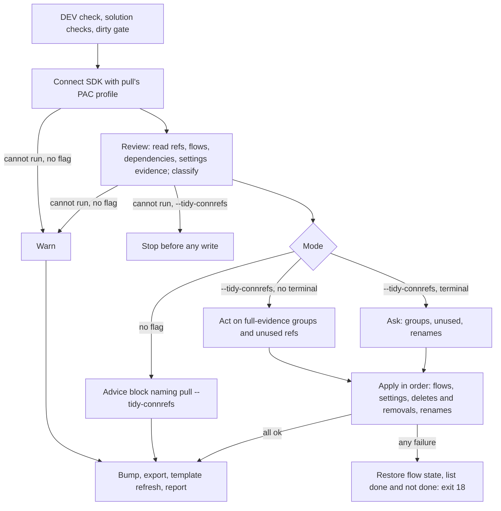
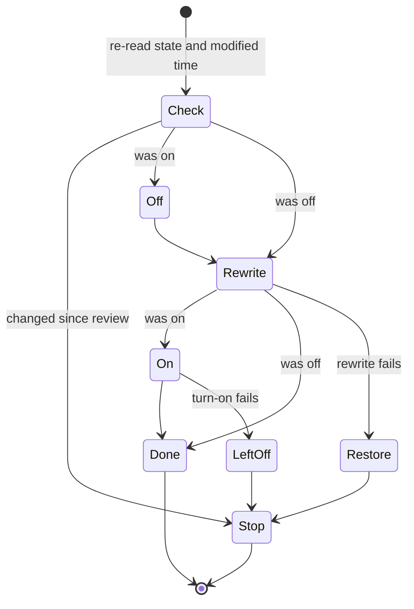

# Pull Connection Reference Cleanup - Plan

## Goal Capsule

- **Objective:** A `pull` no longer commits avoidable connection references. Duplicates that hold the same connection are folded into one, references nothing uses are removed once someone confirms it, and the references that stay separate carry display names that say what they are for.
- **Means:** a review inside `pull` that runs against DEV after the dirty-tree gate and before the version bump and export, and advises; the fix runs only when the caller passes `--tidy-connrefs` (Key Decisions, KTD1, KTD9).
- **Product authority:** the Product Contract decides behavior; the Planning Contract decides mechanism within it; a unit overrides neither.
- **Execution profile:** one PR, on its own branch with a worktree (`/ce-work` sets it up, per `AGENTS.md` Branching).
- **Stop conditions:** stop and ask if U1 shows that Dataverse refuses a flow definition update even while the flow is off, that turning a re-pointed flow back on fails for a reason the caller cannot fix, or that the rewrite needs more than the map entry's reference fields. Stop and ask if any requirement turns out to need persistent state on disk.
- **Finishes the work:** the executor through `/ce-work`. U1 needs a scratch DEV the executor can reach; if none is reachable, the user runs U1's checks. The user ships.
- **Open blockers:** None. U1 needs a reachable scratch DEV (see Finishes the work).

---

## Product Contract

**Product Contract preservation:** changed on 2026-11-25 (user-directed): the fix became opt-in through `--tidy-connrefs`, the `pull --dry-run` added during planning and the scoped `--force` specifier were both dropped, and R16, R17 and R20 were rewritten to match. The cleanup is a helper beside `pull`'s core job, so it never gates or blocks the export. Restructured, no scope change: R3 states its evidence rule in full (a partly bound settings file makes members differ, matching AE9), R9 gains the keeper rule for protected references, R7 states the order of writes, R12 names the patterns' source; the resolved Outstanding Questions moved into KTDs and U1.

### Summary

Before `pull` exports, it reviews the solution's connection references in DEV and says what it found. That review only reads; exporting and unpacking stay `pull`'s core job, and the review never blocks them. When the caller passes `--tidy-connrefs`, `pull` untangles what it found: references that hold the same connection everywhere are merged into the most-used one, references nothing uses are offered for removal, and references that share a connector but use different accounts are either merged on request or kept apart with a clearer display name. The export then captures the cleaned-up state, so source control and every later deploy carry it.

### Problem Frame

Makers create connection references in DEV without meaning to. A maker who creates a new connection from inside the flow designer gets a new reference with it, and the designer's reuse can pick a reference from another solution. The flows keep working, so nobody notices. `pull` exports the duplicates into git, `deploy` ships them, and each one needs its own binding in every environment's settings file. Leftover references that no flow uses travel the same way.

The names make it worse. A generated name carries the connector, the solution name and a random suffix, so the list of references does not tell a reader which one is the integration account and which one is a maker's personal connection. Two references on the same connector bound to different accounts are sometimes deliberate and sometimes a mistake, and today nothing asks.

Flowline already touches connection references in three places, and none of them addresses this. `settings` binds a reference to a connection per environment, the pull change report lists references added or removed, and orphan cleanup flags a reference that source no longer declares for manual handling without deleting it.

### Key Decisions

- **The fix happens in DEV, and `pull` captures it.** Flowline rewrites the live flows and references in DEV, then exports. It never edits unpacked solution source by hand. (session-settled: user-directed, chosen over rewriting flow JSON and Customizations.xml in source: that ships something nobody confirmed in DEV, and the next `pull` would overwrite it.) Governs R1, R7.
- **The cleanup lives inside `pull`.** `pull` is the one gate where DEV state becomes source, it is already DEV-only, and it already writes to DEV before export. (session-settled: user-directed, chosen over a new standalone verb with a hint in `pull`, and over a new `settings` operation: a separate step is easy to forget, so duplicates land in git anyway, and `settings` is per-environment configuration rather than solution content.) Governs R1, R2.
- **A duplicate is judged on every environment, not only DEV.** In DEV most references are bound to the maker's own connection, so DEV alone makes deliberate splits look like duplicates. (session-settled: user-directed, chosen over judging on DEV bindings alone, and over judging on DEV with a warning: a PROD split across two service accounts would be silently merged.) Governs R3, R4.
- **The merge keeps the reference with the most uses.** The most-used reference is treated as the main one. (session-settled: user-directed, chosen over a suggested keeper the user can override.) Governs R6.
- **Ties go to the oldest reference.** Unattended runs need a deterministic keeper, and the oldest is the one most likely already bound everywhere. Governs R6.
- **Flows that are on are turned off for the rewrite and back on afterwards.** It is DEV, so a short off period is acceptable. (session-settled: user-directed, chosen over requiring a flag for the off/on cycle, and over refusing until the user turns flows off.) Governs R8.
- **A removed reference is deleted from DEV only when nothing depends on it.** Otherwise it is only taken out of this solution. The PROD copy is left behind and flagged by orphan cleanup, as today. (session-settled: user-directed, chosen over never deleting, which leaves clutter, and over also deleting the PROD copy at deploy, which changes orphan cleanup for connection references from manual to automatic.) Governs R10, R11.
- **References nothing uses are proposed for removal.** The user asked for this in the same pass as the merge. It is a proposal, not an automatic step, because a reference can be created ahead of the flow that will use it. Governs R5, R10.
- **A rename changes the display name only.** The display name is one field, touches no flow and needs no new binding in any environment. (session-settled: user-directed, chosen over also replacing the logical name: a logical-name change means creating a new reference, re-pointing its flows and deleting the old one, and each rename leaves a PROD orphan and needs a binding carried into every settings file.) Governs R13, R14.
- **The review always runs; the fix is opt-in through `--tidy-connrefs`.** The cleanup is a helper, not a hazard of `pull`'s job: duplicates happen easily in DEV and the user wants help untangling them, not a gate. One flag behaves the same for a person and an agent. (session-settled: user-directed, chosen over an opt-out prompt at every interactive `pull`: that needs a separate flag for agents anyway, and it keeps asking about different-account pairs the user already chose to keep.) Governs R16, R17.
- **The flag is named `--tidy-connrefs`.** It merges, removes and renames, so a whole-job name reads right in the advice for every kind of finding; `connref` is already the token users type in `settings --type connref`. (session-settled: user-directed, chosen over `--dedupe-connrefs`, which undersells removal and renames, and over a fully spelled-out name.) Governs R16, R17.
- **No `pull --dry-run` and no `--force` specifier.** `pull`'s `--force` specifiers guard local overwrites (`dirty`, `config`); putting a DEV write under `--force all` would change what existing scripts do. A run without `--tidy-connrefs` is the preview, so the dry-run exemption in Flowline's agent conventions still holds: every DEV write `pull` makes can be switched off (`--bump none`, no `--tidy-connrefs`), and what is left is reversible with git. (session-settled: user-directed, chosen over adding both flags, which was the earlier planning decision, and over a specifier excluded from `all`.) Governs R16, R20.
- **"Unused" is not "orphan".** In Flowline an orphan is a live component that source no longer declares (`CONCEPTS.md`). A reference that the solution declares but nothing uses is called unused here, to keep the two apart.

### Requirements

**When the step runs**

- R1. `pull` runs the connection reference review against DEV after its existing pre-flight checks and before it bumps the solution version or exports.
- R2. When the review finds nothing to act on, `pull` behaves exactly as it does today, with no extra prompt and no extra output beyond a one-line count under `--verbose`.

**What the review finds**

- R3. A same-connection group is two or more references of one connector that are bound to the same connection in DEV and, in every environment's settings file, are either all bound to the same connection or all undeclared. An environment without a settings file gives no evidence for the group and is named as missing evidence. A file that binds one member and leaves another unbound or undeclared makes the members differ.
- R4. A different-account group is two or more references of one connector that do not meet R3. The review shows each reference's binding per environment so the user can judge it. When some members of a connector meet R3 among themselves, those members form their own same-connection group and the rest form the different-account group.
- R5. An unused reference is one that no component of this solution uses: no cloud flow, canvas app, agent or other component that depends on it. A reference is never called unused when a dependency check failed or a flow's definition could not be read.
- R6. For a group, the keeper is the reference with the most uses by components of this solution, each flow or other component counting once, with ties going to the oldest. R9 overrides this when a member is used by a non-flow component. The review names the keeper and the flows that would move.

**Merging**

- R7. Merging a group points every cloud flow of this solution that uses a non-kept reference at the keeper, then treats the non-kept references as removable under R10. All re-pointing happens before any settings file is edited, and settings files are edited before any reference is deleted or removed.
- R8. A flow that is on when it has to be rewritten is turned off, rewritten and turned on again. A flow that cannot be turned on again is named in the result.
- R9. Only cloud flows are re-pointed. A reference that a non-flow component of this solution uses (a canvas app, an agent) becomes the keeper of its group; a group with two such references is not merged, and the review says why.

**Removing**

- R10. A removable reference is deleted from DEV when nothing in the environment depends on it, inside or outside this solution. Otherwise it is only removed from this solution, and the review says what still depends on it.
- R11. Every reference that is deleted or removed from the solution also loses its entry in each environment's settings file.

**Renaming**

- R12. A reference is flagged as having a generated display name when its name matches the platform's default naming shape, as confirmed against real exports in U1.
- R13. The review offers a display-name rename for each reference in a different-account group the user keeps separate, and for each flagged reference that survives the merges. Flowline suggests a name built from the connector and the bound account, which the user can accept or edit.
- R14. A rename never changes a reference's logical name and never changes a binding.

**Interaction and unattended runs**

- R15. With `--tidy-connrefs` at a terminal, the review asks one confirmation for all same-connection groups together, one question per different-account group, one question for the unused references, and one per rename offer. The same-connection confirmation names, per group, any environment with missing evidence.
- R16. Without `--tidy-connrefs`, `pull` changes nothing in DEV for connection references, at a terminal or not. When the review finds something, `pull` prints a short advice block: how many same-connection groups, different-account groups, unused references and generated names it found, and a line naming `pull --tidy-connrefs` as the fix. It then continues with the export. Where the advice's counts come from is decided by measurement (KTD13); if they come from the exported source, the block says "possible", because only the flagged run checks live DEV.
- R17. With `--tidy-connrefs` and no terminal, `pull` merges same-connection groups that have no missing evidence and removes unused references. Different-account groups and renames are only reported, because they need a person's judgment or a name.
- R18. When any merge, removal or flow reactivation fails, `pull` stops before the version bump and the export, and names what was done and what was not. Running `pull` again resumes from the state DEV is in.
- R19. The `pull` result lists each merge, removal and rename it made, so the change can be described in the commit.
- R20. Without `--tidy-connrefs`, the review never blocks the export: when it cannot run (no SDK connection, a malformed settings file, a failed read), `pull` prints one warning and continues as it does today. With `--tidy-connrefs`, a review that cannot run stops `pull` before any write, because the caller asked for the cleanup.

### Key Flows

- F1. Interactive pull with duplicates
  - **Trigger:** A developer runs `pull --tidy-connrefs` at a terminal after building flows in DEV, usually after a plain `pull` advised it.
  - **Steps:** The existing pre-flight passes. The review finds two same-connection groups, one different-account group, one unused reference and three generated names. The developer confirms the two same-connection merges in one answer, keeps the different-account pair separate and renames both, removes the unused reference, and accepts one of the suggested renames. Flows are re-pointed and cycled off and on, settings entries are removed, and leftovers are deleted or removed from the solution. `pull` then bumps the version and exports.
  - **Outcome:** The commit holds one reference per real connection, clear names on the kept pair, and settings files without the removed entries.
  - **Covered by:** R1, R3, R4, R5, R6, R7, R8, R10, R11, R13, R15, R19
- F2. Unattended pull with the flag
  - **Trigger:** A script or agent runs `pull --tidy-connrefs` with no terminal.
  - **Steps:** The review runs. Same-connection groups with full evidence are merged and unused references removed; different-account groups and generated names are only reported. `pull` then bumps and exports.
  - **Outcome:** Unattended runs never make a judgment call on behalf of a person.
  - **Covered by:** R17, R18
- F3. Pull without the flag
  - **Trigger:** A developer or agent runs `pull`, at a terminal or not.
  - **Steps:** The review runs and only reads. When it finds something, the advice block prints, naming `pull --tidy-connrefs`. The export runs as it does today.
  - **Outcome:** The user learns the duplicates exist, and nothing in DEV changed for them. This run is also the preview of what the flag would act on.
  - **Covered by:** R2, R16, R20

### Acceptance Examples

- AE1. **Covers R3, R4.** **Given** `ref_A` and `ref_B` are both bound to the same Dataverse connection in DEV, **and** the PROD settings file binds `ref_A` to `svc-integration` and `ref_B` to `svc-reporting`, **when** `pull` runs the review, **then** the pair is a different-account group, not a same-connection group, and both PROD bindings are shown.
- AE2. **Covers R6.** **Given** a same-connection group where `ref_A` is used by five flows and `ref_B` by two, **when** the group is merged, **then** the two flows move to `ref_A` and `ref_B` becomes removable.
- AE3. **Covers R9.** **Given** `ref_A` is used by four flows, **and** `ref_B` by one flow and a canvas app in this solution, **when** their group is merged, **then** `ref_B` is the keeper and the four flows move to it.
- AE4. **Covers R10.** **Given** `ref_B` has no users left in this solution but a flow in another solution still uses it, **when** it is removed, **then** it is taken out of this solution, stays in DEV, and the review names the flow in the other solution.
- AE5. **Covers R8, R18.** **Given** a merge re-points three flows that were on, **and** the third cannot be turned on again, **when** `pull` runs, **then** `pull` stops before the version bump, names the third flow as left off, and does not export.
- AE6. **Covers R16.** **Given** a `pull` without `--tidy-connrefs` finds one same-connection group, **when** it runs, at a terminal or not, **then** it prints the advice block naming `pull --tidy-connrefs`, asks nothing, changes nothing in DEV, and exports.
- AE7. **Covers R13, R14.** **Given** the developer keeps a different-account pair separate and accepts the suggested names, **when** the rename runs, **then** both display names change and both logical names and bindings stay as they were.
- AE8. **Covers R3, R17.** **Given** `ref_A` and `ref_B` share a connection in DEV and in the TEST settings file, **and** there is no PROD settings file, **when** an unattended `pull --tidy-connrefs` runs, **then** the group is reported with PROD named as missing evidence and is not merged.
- AE9. **Covers R3.** **Given** the UAT settings file binds `ref_B` but leaves the keeper `ref_A` unbound, **when** the review runs, **then** the pair is a different-account group and UAT is named.
- AE10. **Covers R7, R18.** **Given** a merge re-pointed every flow, **and** saving the settings files then failed, **when** `pull` is run again, **then** the leftover references are found as unused and their removal edits the settings files again.
- AE11. **Covers R20.** **Given** the UAT settings file is malformed, **when** `pull` runs without `--tidy-connrefs`, **then** it prints one warning that the review could not run, exports, and exits as it would have without the review; **and when** `pull --tidy-connrefs` runs, **then** it stops with the config error before any write to DEV.

### Scope Boundaries

- Logical-name renames. Deferred; they would reuse the merge mechanics, as a merge into a newly created reference.
- Deleting the PROD copy of a removed reference at deploy. Orphan cleanup keeps flagging it for manual handling.
- Re-pointing canvas apps, agents, or flows in other solutions.
- Connections themselves: listing, repairing or deleting connections, or changing who owns them.
- Comparing references across solutions, or cleaning up references this solution does not contain.
- Preventing duplicates when makers create them. Flowline does not control the flow designer.
- Settings files at a custom `--settings-file` path outside the role naming convention. The cleanup cannot find them, so their entries stay; `settings apply` already skips an entry whose component is absent.

### Dependencies / Assumptions

- Users read `pull`'s output, so the advice block (R16) is how they learn to pass `--tidy-connrefs`. If duplicates stay unfixed after this ships, the fallback is an opt-out prompt at the terminal; that was the runner-up, and it is a small change on top of this design.
- `pull --tidy-connrefs` at a terminal is the common way to fix, which is what makes R15 worth building. Unattended runs with the flag (R17) cover only the safe subset.
- Running the live review on every `pull` is fast enough for solutions with many flows. Unmeasured; one definition read per flow and one dependency check per reference. U1 times it, and KTD13 falls back to a source-only advice check if it is too slow.
- The platform's default naming shape is stable enough to detect (R12). Microsoft documents it as connector plus solution name plus a random suffix; U1 confirms the patterns.

### Sources / Research

- `src/Flowline/Commands/PullCommand.cs:42` lists `pull`'s current `--force` specifiers; `:48-50` is the DEV-only check, which discards the PAC profile today; `:82-102` is the dirty gate on the unpacked source; `:104-127` bumps the live version, then syncs; `:172` refreshes the shared settings template.
- `src/Flowline.Core/OrphanCleanup/EntityDetectionHelper.cs:66-68`: connection references are never deleted automatically and are flagged for manual handling.
- `src/Flowline.Core/Configure/ComponentValueWriter.cs:130-133` binds a reference by an SDK update; `src/Flowline.Core/Configure/ComponentStateWriter.cs:44-64` writes flow state through statecode and statuscode.
- `src/Flowline.Core/Configure/SettingsSectionEntries.cs:28` and `src/Flowline.Core/Configure/SettingsFileGaps.cs:70`: settings-file reference entries carry LogicalName, ConnectionId and ConnectorId.
- `src/Flowline/Utils/PacConnections.cs:41-48` lists connections through `pac`, limited to what the signed-in identity can see.
- `src/Flowline/Utils/SolutionChangeSummary.cs:313-330` already reports reference adds, removes and display-name changes in CHANGES.md. Nothing in `src/` reads a flow's `clientdata` or writes a reference's display name.
- `.claude/skills/cli-for-agents/SKILL.md`: `ConfirmGated`, scoped `--force` (§3), and the `--dry-run` rule with `pull`'s exemption in §4, which rests on C6 in `docs/reviews/2026-09-08-cli-command-surface-design-review.md:250-252` ("`sync --bump none`, read the summary, `git checkout -- Solution/src` is the dry run").
- `src/Flowline/Commands/PullCommand.cs:116` writes the solution version to DEV on every `pull` unless `--bump none`; `:35` is the existing opt-out flag precedent, `--no-build`.
- Microsoft Learn, "Use a connection reference in a solution": the designer reuses existing references from this or other solutions before creating one, a new connection created in the designer creates a reference, and default names carry connector, solution name and a random suffix.
- Microsoft Learn, "Work with cloud flows using code": `clientdata` holds the flow definition and its `connectionReferences` map; each map entry carries `connection.connectionReferenceLogicalName` (and in the sample also `connection.name`), and actions point at the map key through `host.connectionName`; flows are updated through the workflow table.
- Microsoft Learn, "Check for solution component dependencies": `RetrieveDependenciesForDelete` lists what would block deleting a component.
- Power Platform ToolBox tool "Connection Reference Governance" (https://github.com/vincenzosgueradev/connection-reference-governance): the reference GUI tool for this idea, single-environment and interactive. Its author reports that Dataverse refuses a definition update on a flow that is on; U1 confirms.

---

## Planning Contract

### Key Technical Decisions

- KTD1. **The cleanup runs between the dirty gate and the version bump in `pull`, on an SDK connection made with the PAC profile `pull` already resolves.** `pull` is pac-only today, and the DEV check at `PullCommand.cs:50` returns the profile and throws it away. Keeping it avoids a second profile prompt and keeps the SDK and `pac` calls on one identity. All prompts run outside any spinner, because a prompt inside `Console.Status()` throws. Governs R1, R18.
- KTD2. **The engine lives in a new Core feature folder, `src/Flowline.Core/ConnectionReferences/`; `PullCommand` owns the flag, prompts, the advice block and exit codes.** The cleanup needs only the SDK and files, so the project boundary rule in `AGENTS.md` puts it in Core. It splits into a read step that produces a review, a pure classifier, and an apply step that takes the confirmed choices.
- KTD3. **A use is counted per flow.** A flow counts once for each reference its definition map names, however many map entries name it. The rewrite changes every entry naming a non-kept reference, including stale entries no action points at. Governs R6, R7.
- KTD4. **Re-pointing rewrites only the map entry's reference fields.** Each entry naming a non-kept reference gets the keeper's logical name, and `connection.name` is removed or set to match the keeper, whichever U1 shows the platform accepts on turn-on. Action and trigger keys stay untouched, so no action in the definition changes. Governs R7.
- KTD5. **One flow at a time: read freshness, off if on, rewrite, back on.** The review records each flow's state, last-modified time and row version. Before writing, the flow is re-read; if a maker changed it since the review, the cleanup stops instead of overwriting (R18). The definition update itself is conditional on the row version read (Dataverse optimistic concurrency), so a save that lands between the re-read and the write is a mismatch and the same stop, not a lost edit. A Suspended flow in a group puts that group in the "not merged" bucket with a reason, because Suspended cannot be restored by a write. Turning a flow back on runs in a finally path on a fresh token with a short timeout, so a failure or Ctrl+C still restores it; anything left off is listed in the stop message. A hard kill can still leave a flow off; nothing is stored on disk to recover that (Stop condition). Governs R8, R18.
- KTD6. **Write order is fixed: re-point flows, then settings files, then deletes and removals, then renames.** Wherever a failure lands, the next `pull` finds the remaining work: a reference whose flows already moved shows up as unused, and its removal edits the settings files again. The shared settings template is edited in the same settings step, which runs before `RefreshSharedTemplateAsync`, so the template's vanished-entry carry does not put a removed entry back. Governs R7, R11, R18.
- KTD7. **Settings evidence comes from the role files `deploymentSettings.<role>.json` for each non-DEV role in `EnvironmentRoles.All`, beside the cdsproj.** A role without a file is missing evidence. The shared `deploymentSettings.json` gives no evidence, because its connection ids are empty by design, but it is edited by R11 like the role files. A malformed settings file ends the review with the existing config error rather than being skipped; R20 decides whether that error is a warning (no flag) or stops `pull` (with the flag). Comparisons are case-insensitive. Governs R3, R11.
- KTD8. **"Can't tell" means "in use".** A flow whose definition is empty or does not parse, or a dependency check that faults, makes every reference it might touch ineligible for "unused" and for delete. The `RetrieveDependenciesForDelete` precedent in `WebResourceDependencyChecker` treats a fault as unchecked and moves on; this cleanup inverts that. The delete check also reads other-solution membership, as orphan cleanup does, and a reference held by another solution is only removed from this one. The connection reference component type is read from its `solutioncomponent` row, because it is environment-specific. Governs R5, R10.
- KTD9. **One boolean flag, `--tidy-connrefs`, decides the mode; it is not a `--force` specifier.** `pull`'s force specifiers stay `dirty`, `config`, `all` (`PullCommand.cs:42`), so `--force all` keeps meaning local overwrites only. Mode: no flag means advise; flag at a terminal means ask (R15); flag with no terminal means act on R17's subset. `ConfirmGated` does not fit, because it throws when unattended and unforced, while the flag itself is the unattended consent; the mode is decided up front, as `SettingsComponentCommands.CanOffer` does. Merges and the removal of their leftovers sit under the one flag, so a run cannot merge and then strand the leftovers. Governs R15, R16, R17.
- KTD10. **A stopped cleanup exits with `PartialSuccess` (18).** It is only reachable with `--tidy-connrefs`, so the caller asked for the writes, part of them landed, and the recovery is "fix, then re-run", which is what that code already means for deploy and `settings apply`. Its description is extended to name `pull`. A run without the flag never changes `pull`'s exit code, including when the review could not run. Governs R18, R20.
- KTD11. **The advice block and the fix share one review.** Without the flag the review prints its counts and stops there; with the flag the apply step consumes that same review, so the advice a user acted on cannot drift from what the flag does. `pull` gets no `--dry-run`: the run without the flag is the preview, and §4's exemption is restated rather than dropped (U6). Governs R16, R20.
- KTD12. **Rename suggestions come from the connector name plus the bound account's display name when the caller can see that connection, else the connector name alone.** `pac connection list` only returns the caller's own connections, so the account part is best effort. The suggestion is a starting point the user edits. Name collisions with an existing display name are refused at the prompt. Governs R13.
- KTD13. **The advice without the flag uses the live review by default; a source-only check is the fallback if U1's timing says the live review is too slow.** Both feed the same pure classifier (U2), so the fallback changes only the input. (session-settled: user-directed, chosen over committing to either source before measuring.)
  - **Default, live review:** the same read the flagged run does, before the export. Exact counts, but every `pull` opens an SDK connection and reads each flow's definition and each reference's dependencies.
  - **Fallback, source-only:** after the export, next to the drift warnings (`PullCommand.cs:150-170`), read the unpacked solution: references and display names from `Customizations.xml` (already parsed at `SolutionChangeSummary.cs:313-330`), flow reference maps from the unpacked flow definitions, and the role settings files. No call to DEV, and no SDK connection without the flag. It flags two or more references on one connector as possible duplicates, a reference no flow in source names as possibly unused, and generated display names. It cannot see the DEV connection or canvas app and agent use, so the block says "possible".
  - **Threshold:** fall back when the live review adds more than 5 seconds, or more than 10% of the `pull` time, on U1's timing solution. Proposed numbers; the user confirms them when U1 reports.
  - Governs R16.

### High-Level Technical Design

Where the cleanup sits in `pull`, and what each mode does:

Classifying one connector's references (R3, R4, R5, R9):

| Situation | Result |
|---|---|
| Members share the DEV connection, and every role file binds them all to one connection or declares none of them | Same-connection group |
| As above, but a role has no settings file | Same-connection group with that role named as missing evidence; interactive only |
| Some members match each other under the rows above, others do not | The matching members form a group; the rest form a different-account group |
| Members differ in DEV or in any role file, including a file that binds one member and leaves another unbound or undeclared | Different-account group |
| A group contains a Suspended flow user, or two members used by a canvas app or agent | Not merged, reason shown |
| No component of this solution uses the reference, and every flow parsed and every dependency check succeeded | Unused |

Per flow during a merge (KTD5):

### Assumptions

- A flow definition update is accepted while the flow is off, and turning it on again revalidates against the keeper's binding without extra steps. U1 confirms or triggers the stop condition.
- The workflow table's separate connection-references column is derived from the definition and does not need its own write. U1 confirms.
- The Dataverse client's built-in retry handles throttling during the review; a write that still fails is a failure under R18.

### System-Wide Impact

- **Agents and scripts:** a `pull` without `--tidy-connrefs` writes nothing new to DEV and keeps its exit codes; the only visible change is the advice block. `--force all` is unchanged. An agent that reads the advice can re-run with the flag.
- **Every `pull`:** with the KTD13 default, it opens an SDK connection to DEV and reads references, flows and dependencies, flag or not. With the fallback, a `pull` without the flag stays pac-only and only reads local files. U1's timing decides which.
- **Exit-code contract:** `PartialSuccess` gains a `pull` meaning; the contract tables in the shipped skill and wiki 12-AI-Agents change with it (U6).
- **Orphan cleanup:** gains a shared removal call (U4) with no behavior change; its connection reference handler stays report-only.
- **Settings files:** `pull` now edits role files as well as the shared template, so a `pull` can leave settings changes to commit alongside the solution source.

### Risks

| Risk | Mitigation |
|---|---|
| A flow is left off after a hard kill mid-cycle and exported as off | One flow off at a time (KTD5) keeps the window small; the stop message lists flows left off; accepted, not persisted |
| A re-pointed flow in a different-account merge needs a connection the caller cannot use, so turn-on fails | Stops under R18 with the flow named; the user fixes sharing and re-runs |
| The rewrite misses a field the platform checks on turn-on | U1 captures a real definition and proves the rewrite on it before U4 is built |
| Removing a reference from this solution breaks a fresh install where another solution's flow uses it | Only reachable when another solution's flow uses it; R10 keeps it in DEV, and the review names that flow |

---

## Implementation Units

### U1. Prove the flow rewrite against a real DEV

- **Goal:** Confirm how a cloud flow's definition is re-pointed and cycled, and capture fixtures the tests build on.
- **Requirements:** R7, R8, R12, R16; settles the Assumptions, KTD4's open branch and KTD13's choice.
- **Dependencies:** none.
- **Files:** `tests/Flowline.Core.Tests/ConnectionReferences/Fixtures/` (captured flow definitions with one and two map entries, and a sample of generated reference names); findings recorded in this plan's Assumptions and KTD4.
- **Approach:**
  1. In a scratch DEV, create a solution with two references on one connector, both bound to the same connection, and two flows using them, one on and one off.
  2. Capture both flows' `clientdata` and the references' display and logical names.
  3. Try a definition update on the flow that is on; record whether it is refused.
  4. With the flow off, change the map entry's logical name to the other reference, with and without `connection.name`; turn it on; record which form succeeds and whether the workflow's connection-references column changed by itself.
  5. Record the default display-name and logical-name patterns from three generated references.
  6. Repeat step 4 with the flow and connection created by one identity and the rewrite and turn-on run by a second identity with System Customizer or higher; record whether turn-on succeeds. If it fails, stop and ask before U4, because a shared DEV makes this the common case.
  7. Confirm the workflow table honors a row-version-conditional update (KTD5).
  8. Time the live review's reads (SDK connect, reference read, flow definition read, one dependency check per reference) against a plain `pull --bump none` on the same solution. Use a solution with at least 30 cloud flows and 10 references, or the largest one available, and record both numbers. Apply KTD13's threshold, and report the result to the user before U5.
  9. Confirm that the unpacked solution's flow definitions carry each flow's connection reference map with the logical names, which the KTD13 fallback needs. If they don't, the fallback can only flag possible duplicates and generated names, and U1 records that.
- **Execution note:** This is a live check, not code. Scrub tenant ids, connection ids and names from captured fixtures before committing them.
- **Test expectation:** none, it produces fixtures and findings.
- **Verification:** The Assumptions read as confirmed or the stop condition fires; the fixture folder holds scrubbed definitions; KTD13 records the measured times and the chosen advice source.

### U2. Read and classify connection references

- **Goal:** A Core read step that turns live DEV state plus settings evidence into a review: groups, keepers, unused references, flagged names, and reasons.
- **Requirements:** R3, R4, R5, R6, R9, R12; KTD3, KTD7, KTD8.
- **Dependencies:** U1 (fixtures and name patterns).
- **Files:**
  - `src/Flowline.Core/ConnectionReferences/ConnectionReferenceReview.cs` (read: solution components, references with display name, created on, connector and connection; cloud flows with state, modified time and definition; dependency and other-solution checks)
  - `src/Flowline.Core/ConnectionReferences/ConnectionReferenceClassifier.cs` (pure: groups, keepers, unused, generated names)
  - `src/Flowline.Core/ConnectionReferences/FlowConnectionMap.cs` (parse a definition's reference map; KTD3 counting)
  - `src/Flowline.Core/ConnectionReferences/SettingsEvidence.cs` (role files per KTD7)
  - `tests/Flowline.Core.Tests/ConnectionReferences/ConnectionReferenceClassifierTests.cs`, `FlowConnectionMapTests.cs`, `ConnectionReferenceReviewTests.cs`, `SettingsEvidenceTests.cs`
- **Approach:**
  1. Mirror `SolutionComponentInventory` for the solution-component join and the reference read, adding display name and created on; use `RetrieveAllAsync` with `NoLock` and `EntityNameLookup.EnsureInLimit`.
  2. Read the component type of each reference from its `solutioncomponent` row (KTD8).
  3. Keep the classifier free of I/O so the decision table in the HTD is tested directly.
- **Patterns to follow:** `src/Flowline.Core/Configure/SolutionComponentInventory.cs`, `src/Flowline.Core/WebResources/WebResourceDependencyChecker.cs` (request shape only, with the fault policy inverted), `src/Flowline.Core/Configure/SettingsFileLocator.cs`, `src/Flowline.Core/Configure/SettingsFileReader.cs`.
- **Test scenarios:**
  - Covers AE1. Two references share the DEV connection, PROD binds them differently: different-account group with both PROD bindings.
  - Covers AE8. Same in DEV and TEST, no PROD file: same-connection group with PROD as missing evidence.
  - Covers AE9. Keeper unbound in UAT, member bound: different-account group naming UAT.
  - Three references where two match everywhere and one differs: a same-connection pair plus a different-account group.
  - Covers AE2. Use counts five and two: keeper is the five.
  - Equal use counts: keeper is the older reference by created on.
  - Covers AE3. A member used by a canvas app becomes keeper; two such members: not merged with reason.
  - A group with a Suspended flow user: not merged with reason.
  - A flow with two map entries naming the same reference counts once.
  - A flow with an empty or unparsable definition: no reference it might name is unused.
  - A dependency check that faults: the reference is not unused and not deletable.
  - A reference no component uses, all checks succeeded: unused.
  - Display names matching U1's generated patterns are flagged; a hand-made name is not.
  - Settings files compare ids case-insensitively; the shared template gives no evidence; a malformed role file raises the config error.
- **Verification:** Classifier tests cover every row of the HTD decision table.

### U3. Edit settings files without disturbing them

- **Goal:** Remove a reference's entry from every role file and the shared template, keeping everything else in each file byte-identical.
- **Requirements:** R11; KTD6, KTD7.
- **Dependencies:** none.
- **Files:** `src/Flowline.Core/Configure/SettingsSectionEntries.cs` (add an entry-removal helper), `src/Flowline.Core/ConnectionReferences/SettingsEntryRemover.cs`, `tests/Flowline.Core.Tests/ConnectionReferences/SettingsEntryRemoverTests.cs`.
- **Approach:** Use `SettingsFileReader.Read` and `Save`, which preserve order and line endings and write atomically; match on LogicalName case-insensitively; skip files that do not declare the reference.
- **Patterns to follow:** `src/Flowline.Core/Configure/SettingsTemplateService.cs`, `src/Flowline.Core/Configure/ConfigurePullService.cs`.
- **Test scenarios:**
  - Removing one entry from a CRLF file leaves every other byte unchanged.
  - A file that does not declare the reference is not rewritten.
  - The shared template loses the entry, and a following template refresh does not bring it back.
  - Removing two entries from one file in one pass.
- **Verification:** Round-trip tests pass on LF and CRLF fixtures.

### U4. Apply the confirmed cleanup to DEV

- **Goal:** A Core apply step that takes the review plus the user's confirmed choices and performs re-points, settings edits, deletes or removals, and renames in KTD6's order, returning per-item outcomes.
- **Requirements:** R7, R8, R10, R11, R14, R18, R19; KTD4, KTD5, KTD6, KTD8.
- **Dependencies:** U1, U2, U3.
- **Files:**
  - `src/Flowline.Core/ConnectionReferences/ConnectionReferenceCleanup.cs`
  - `src/Flowline.Core/Solutions/SolutionComponentRemoval.cs` (the `RemoveSolutionComponent` call extracted from `OrphanCleanupService`)
  - `src/Flowline.Core/OrphanCleanup/OrphanCleanupService.cs` (use the extracted call)
  - `tests/Flowline.Core.Tests/ConnectionReferences/ConnectionReferenceCleanupTests.cs`
- **Approach:**
  1. Re-point flows one at a time per KTD5, reusing `ComponentStateWriter.ApplyAsync` for off and on and a direct workflow update for the definition.
  2. Run the settings step from U3.
  3. For each removable reference, re-run the delete check; delete when clear, else remove from the solution; use `ComponentStateWriter.IsDependencyFault` as the backstop on delete.
  4. Apply renames as a display-name update, mirroring `ComponentValueWriter`'s binding update.
  5. Stop at the first failure and return what was done and what was not.
- **Patterns to follow:** `src/Flowline.Core/Configure/ComponentStateWriter.cs`, `src/Flowline.Core/Configure/ComponentValueWriter.cs`, `OrphanCleanupService` cross-solution membership check.
- **Test scenarios:**
  - Happy path: a group of two, three flows on, one off; each on-flow sees off, rewrite, on in that order; the off-flow sees only the rewrite.
  - Covers AE5. Turn-on fails for the third flow: stop, third flow listed as left off, no settings edit, no delete.
  - A rewrite fails: that flow is turned back on, then stop.
  - A flow modified since the review: no write to it, stop with the flow named.
  - The definition update fails on a row-version mismatch: treated as changed since the review, flow turned back on, stop.
  - Cancellation during the cycle: the flow is turned back on with a fresh token.
  - Covers AE4. A reference another solution's flow uses: removed from this solution, not deleted.
  - A reference held by another solution with no dependents: removed from this solution, not deleted.
  - A delete that faults with a dependency error: falls back to removal from the solution.
  - Covers AE10. Settings save fails after re-points: stop; a fresh review then reports the leftovers as unused.
  - Covers AE7. A rename writes only the display name; logical name and binding are untouched.
  - The rewritten definition differs from the original only in the map entries' reference fields (U1 fixture).
- **Verification:** Outcomes list every item with its result; tests assert call order on the fake service.

### U5. Wire the cleanup into `pull`

- **Goal:** `pull` runs the review, advises without the flag, asks or acts with `--tidy-connrefs`, applies, and stops or continues.
- **Requirements:** R1, R2, R13, R15, R16, R17, R18, R19, R20; F1, F2, F3; KTD1, KTD9, KTD10, KTD11, KTD12.
- **Dependencies:** U2, U3, U4.
- **Files:**
  - `src/Flowline/Commands/PullCommand.cs`
  - `src/Flowline.Core/ExitCode.cs` (extend `PartialSuccess`'s description)
  - `tests/Flowline.Tests/PullCommandTests.cs`
- **Approach:**
  1. Inject `DataverseConnector`; keep the PAC profile from the DEV check; connect after the dirty gate. With the KTD13 fallback, connect only when `--tidy-connrefs` is passed, and run the source-only advice after the export.
  2. Add `--tidy-connrefs` to the pull settings, with the description "Merge duplicate connection references, remove unused ones and rename default names in DEV". The force specifiers stay as they are.
  3. Decide the mode up front (KTD9); prompts run outside spinners.
  4. Without the flag, catch a review that cannot run and print one warning (R20); with it, let the error stop `pull`.
  5. Build rename suggestions from `PacConnections` (KTD12).
  6. Print the advice, review and results naming references and flows only, never connection ids.
  7. On a stop, throw `PartialSuccess` with done and not-done lists; on success, continue to the bump.
  8. Keep the mode decision and advice and report formatting as `internal static` seams for tests.
- **Patterns to follow:** `SettingsComponentCommands.CanOffer` for the interactive-or-report gate, `SettingsApplyCommand`'s connect-then-report shape, `docs/tone-of-voice.md` for every message.
- **Test scenarios:**
  - Mode gate: no flag advises, at a terminal or not; flag at a terminal asks; flag with no terminal acts; `--force all` without the flag still advises.
  - Covers AE6. Without the flag: the advice block names `pull --tidy-connrefs` and the decision is "advise".
  - Covers AE8. Flag with no terminal: a group with missing evidence is excluded from the act set.
  - Covers AE11. A review that cannot run: a warning and the export without the flag; a stop before any write with it.
  - R2: an empty review prints only under `--verbose`.
  - The stop message names done items, not-done items and flows left off.
- **Verification:** A Release build of `pull --bump none` against a scratch DEV with a seeded duplicate prints the advice block and leaves DEV unchanged; `pull --tidy-connrefs` at a terminal merges the duplicate and the export shows one reference.

### U6. Update docs and contracts

- **Goal:** Every surface that documents `pull`, its flags or exit codes matches the new behavior.
- **Requirements:** R16, R17, R18, R20; KTD9, KTD10, KTD11.
- **Dependencies:** U5.
- **Files:**
  - `src/Flowline/Program.cs` (pull description and a `--tidy-connrefs` example)
  - `README.md` (pull row)
  - `CHANGELOG.md` (Unreleased: Added for `--tidy-connrefs`, Changed for `pull` now reading DEV connection references and printing advice)
  - `plugin/skills/flowline/SKILL.md` (pull behavior, the new flag, exit-code table)
  - `.claude/skills/cli-for-agents/SKILL.md` (§4 keeps `pull`'s exemption and restates why: every DEV write `pull` makes can be switched off, `--bump none` and no `--tidy-connrefs`; one line that an opt-in helper action gets a boolean flag, not a `--force` specifier; §9 fixes the stale `PullCommand.cs:30-33` cite)
  - `docs/ALM-strategy.md` (one line in §9 that DEV-side reference removal leaves the PROD copy to orphan cleanup)
  - `../Flowline.wiki/07-Pull.md`, `../Flowline.wiki/04-Command-Reference.md`, `../Flowline.wiki/12-AI-Agents.md` (read `../Flowline.wiki/AGENTS.md` first)
- **Approach:** Close with the literal search over `Program.cs`, `src/Flowline/Templates/` and `plugin/skills/` from `docs/solutions/conventions/cli-surface-change-doc-sweep.md`; run `/tone` on changed `.cs` files when available, else check against `docs/tone-of-voice.md`.
- **Test expectation:** none, documentation only.
- **Verification:** The doc-sweep search finds no stale `pull` flag list; wiki pages updated or the reason they could not be is reported.

---

## Verification Contract

| Gate | Command or check | Proves |
|---|---|---|
| Build | `dotnet build Flowline.slnx` | Compiles; Core does not reference `Flowline` |
| Core tests | `dotnet test tests/Flowline.Core.Tests/Flowline.Core.Tests.csproj` | U2, U3, U4 behavior |
| CLI tests | `dotnet test tests/Flowline.Tests/Flowline.Tests.csproj` | U5 seams, mode gate |
| Full suite | `dotnet test Flowline.slnx` | Nothing else broke (cross-cutting: orphan cleanup extraction) |
| Live smoke | Release build of `pull --bump none` (advice, DEV unchanged) and `pull --tidy-connrefs` at a terminal against a scratch DEV with a seeded duplicate | R1, R15, R16 end to end; messages per `docs/tone-of-voice.md` |
| Docs | Literal search from `docs/solutions/conventions/cli-surface-change-doc-sweep.md` | U6 |

CI source of truth is `.github/workflows/ci.yml`. Use a Release build to judge user-facing output, because Debug propagates exceptions as stack traces.

## Definition of Done

- Every unit's verification holds, and U1's findings are written into Assumptions and KTD4.
- Build, Core tests, CLI tests and the full suite pass.
- The live smoke ran, or the final report says it did not and why.
- No connection id or secret appears in any output or committed fixture.
- Docs in U6 are updated, including the wiki or a stated reason it could not be.
- Code from abandoned approaches is removed from the diff.
- The final response lists the validation that ran and anything not verified.

---

## Deferred / Open Questions

None open.

### Resolved 2026-11-25

- **Should `--force all` include the cleanup?** (2026-11-23 review, P1, adversarial, confidence 75.) Moot: the cleanup has no force specifier. It runs only with `--tidy-connrefs` (KTD9), so `--force all` keeps its current meaning and no existing script changes behavior.
